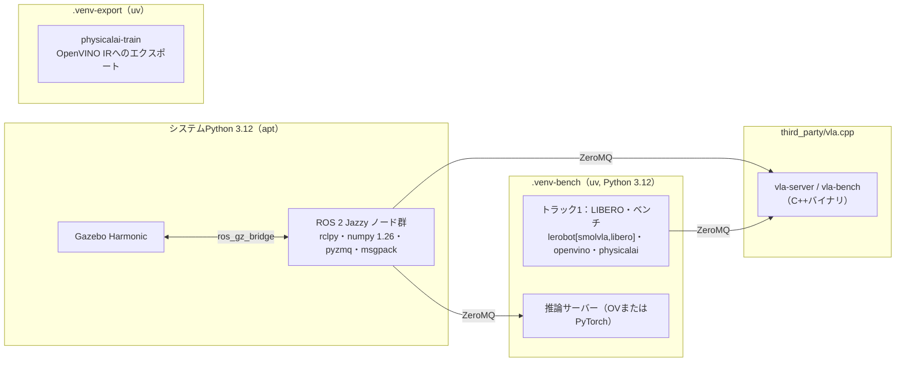

# 01. リポジトリ設計：構成・プロセス分離・データ形式

> **ハンズオン**（共通の進め方は [03_fill_in_guide](03_fill_in_guide.md)）
> - この章で埋める穴：**19個**（`src/evla/common/` の `run_id.py` 5、`config.py` 6、`sysinfo.py` 7、`cli.py` 1）
> - ゴール：`pytest tests/common/test_run_id.py tests/common/test_config.py tests/common/test_sysinfo.py` がすべて通る
> - 進め方：1〜4節で設計を読む → **5節のハンズオンを Step 0 から順に**手を動かす → 9節で完了を確かめる。6〜8節は詰まったときに開く

## 1. 目的と計画書の対応

- 実装を始める前に、**どこに何を置くか**、**どのプロセス・venvで何を動かすか**、**結果をどの形式で残すか**を決める。
- 計画書の対応箇所：「環境構成」「プロセス分離」「成果物」

この章の決めごとは、後続の全章が前提にします。

## 2. 前提知識・事前に読む資料

- uv：<https://docs.astral.sh/uv/>（`uv venv`、`uv pip`、`uv run`、`pyproject.toml` の依存定義）
- colconワークスペース：<https://docs.ros.org/en/jazzy/Tutorials/Beginner-Client-Libraries/Colcon-Tutorial.html>
- Python パッケージの `src` レイアウト：<https://packaging.python.org/en/latest/discussions/src-layout-vs-flat-layout/>

## 3. 成果物（最終的なディレクトリ構成）

```
edge_vla_research/
├── edge_vla_research_plan.md
├── docs/                         # このガイド＋自分の設計判断メモ（decisions.md）
├── pyproject.toml                # Pythonパッケージ evla の定義（ROS非依存部分）
├── src/evla/                     # ROSに依存しない共通コード（pytestで単体テストする）
│   ├── common/                   #   config.py, run_id.py, logging.py, paths.py, sysinfo.py
│   ├── policy/                   #   base.py, torch_policy.py, ov_policy.py, vlacpp_policy.py, factory.py
│   ├── bench/                    #   timing.py, memory.py, mode_a.py
│   ├── sim/                      #   libero_env.py, closed_loop.py, executor.py（同期/非同期）
│   ├── ipc/                      #   protocol.py, server.py, client.py（ZeroMQ）
│   ├── grasp/                    #   geometry.py, judge.py（把持判定の純粋関数）
│   ├── dataset/                  #   raw_episode.py, to_lerobot.py
│   └── analysis/                 #   stats.py, pareto.py, plots.py, load.py
├── scripts/                      # CLIエントリポイント（薄く保つ。中身は src/evla を呼ぶだけ）
├── configs/                      # 実験設定YAML（bench/, closed_loop/, sweep/, gazebo/）
├── tests/                        # pytest（src/evla のテスト）
├── third_party/                  # vla.cpp などの外部リポジトリ（git submodule か手動clone。.gitignore対象）
├── ros2_ws/
│   └── src/
│       ├── lerobot_ws/           # Ar-Ray-code/lerobot_ws（外部。変更はしない）
│       ├── evla_sim/             # ament_cmake：world, model, launch, bridge YAML, URDFオーバーレイ
│       └── evla_nodes/           # ament_python：grasp_judge, episode_runner, policy_node
├── results/                      # 実験結果（.gitignore対象。runs/<run_id>/ 単位）
├── data/                         # データセット・モデル（.gitignore対象）
└── reports/                      # 図表と報告書（gitで管理）
```

**【判断】** `src/evla` を ROS から独立した Python パッケージにする理由：

- 把持判定や統計処理などの**ロジックを、ROSを起動せずにpytestで検証できる**。
- ROS側（`evla_nodes`）は「メッセージを受けて `evla` の関数を呼び、結果をpublishする」だけの薄いラッパにする。
- ただし `evla` のうち ROS 側から import する部分（`grasp/`、`ipc/protocol.py`）は、**NumPy 1.26でも動くコードに限定する**（後述の依存制約）。

## 4. インタフェース仕様

### 4.1 プロセスとvenvの分離



| 環境 | Python | 主な依存 | 用途 |
| --- | --- | --- | --- |
| システム（ROS） | 3.12（Ubuntu 24.04のapt） | rclpy、numpy 1.26、`python3-zmq`、`python3-msgpack` | ROSノード（判定、記録、ポリシーノード） |
| `.venv-bench` | 3.12（uv） | `lerobot[smolvla,libero]`、`openvino`、`nncf`、`physicalai`、`pyzmq`、`protobuf`、`psutil`、`pandas`、`matplotlib` | トラック1全般、推論サーバー、データ変換 |
| `.venv-export` | 3.12（uv） | `physicalai-train[nncf]`（`lerobot==0.6.0` を固定で要求） | 学習済みSmolVLAのOpenVINO IRへの書き出し |
| vla.cpp | なし（C++） | libzmq、protobuf、（oneAPI / OpenVINO） | GGUF推論サーバー、`vla-bench` |
| 学習機（RTX PRO 6000、RAM 64GB のサーバー） | 3.12 | `lerobot[smolvla]`（CUDA版torch） | ファインチューニング |

**依存の衝突は実在する**（調査で確認済み）。

- LeRobot 0.6系は `numpy>=2.0`、`requires-python>=3.12` を要求する。
- ROS 2 Jazzy の apt パッケージは Ubuntu 24.04 の NumPy 1.26 でビルドされている。venv に NumPy 2 を入れて rclpy を import すると、C拡張のABI不一致で落ちることがある。
- `physicalai-train 0.3.0` は `lerobot[dataset]==0.6.0` を固定で要求するため、最新のLeRobotと同じ venv に入れると解決に失敗しやすい。

→ **ROSノードの中では lerobot / torch / openvino を import しない**。これを全体のルールにする。

### 4.2 実験ID（run_id）と結果ディレクトリ

```
results/runs/<run_id>/
├── config.yaml          # 実行時の完全な設定（デフォルト値を展開した状態）
├── env.json             # 環境スナップショット（git commit、パッケージ版、CPU、スレッド設定など）
├── samples.parquet      # 生データ（1推論 = 1行、または1エピソード = 1行）
├── summary.json         # 集計値（p50 / p99 / 成功率など）
├── log.txt              # ログ
└── artifacts/           # 動画、図など
```

run_id の形式：`{YYYYmmdd-HHMMSS}_{track}_{mode}_{short-hash}`（例：`20261014-103012_t1_modeA_3fa9c1`）

- `short-hash` は**設定の内容から計算したハッシュ**にする（例：設定をキーでソートしてJSON化し、sha1の先頭6文字）。同じ設定を再実行したことが一目で分かる。

```python
# src/evla/common/run_id.py
def config_hash(cfg: Mapping[str, Any], n: int = 6) -> str:
    """設定辞書から決定的なハッシュを作る（キー順に依存しない）。"""

def new_run_id(track: str, mode: str, cfg: Mapping[str, Any]) -> str:
    """'20261014-103012_t1_modeA_3fa9c1' 形式のIDを返す。"""

def make_run_dir(run_id: str, root: Path = Path("results/runs")) -> Path:
    """ディレクトリを作成して返す。既存なら FileExistsError（上書き事故防止）。"""
```

### 4.3 環境スナップショット（env.json）

```python
# src/evla/common/sysinfo.py
@dataclass(frozen=True)
class EnvSnapshot:
    git_commit: str            # `git rev-parse HEAD`。未コミットの変更があれば末尾に "-dirty"
    hostname: str
    cpu_model: str             # /proc/cpuinfo の model name
    n_logical_cpus: int
    cpu_affinity: list[int]    # os.sched_getaffinity(0)
    mem_total_gb: float
    python: str
    packages: dict[str, str]   # torch, openvino, lerobot, numpy などの版（importlib.metadata）
    thread_env: dict[str, str] # OMP_NUM_THREADS, MKL_NUM_THREADS, VLA_N_THREADS など
    ov_devices: list[str]      # openvino.Core().available_devices（入っていれば）
    timestamp_utc: str

def capture_env() -> EnvSnapshot: ...
```

### 4.4 設定ファイル（YAML＋dataclass）

**【判断】** Hydra などの重いフレームワークは使わず、**dataclass＋YAML**で済ませる。理由：学習コストが小さく、型ヒントで補完が効き、設定ミスを起動時に検出できる。

```python
# src/evla/common/config.py
T = TypeVar("T")

def load_config(path: Path, cls: type[T], overrides: list[str] | None = None) -> T:
    """YAMLを読み、`a.b=3` 形式のoverridesを適用して、dataclass cls に変換する。
    未知のキーがあれば ValueError（タイポの早期検出）。"""

def dump_config(cfg: Any, path: Path) -> None:
    """dataclassをYAMLに書き出す（デフォルト値も含めて全部）。"""
```

### 4.5 結果データの形式

| データ | 形式 | 理由 |
| --- | --- | --- |
| 1推論ごとのレイテンシ | Parquet（pandas） | 列指向で小さく、型が保たれる。CSVのように数値が文字列化しない |
| エピソードごとの結果 | Parquet | 同上 |
| 設定・要約 | YAML / JSON | 人間が読める |
| 把持イベントのログ | JSON Lines（`.jsonl`） | 追記しやすく、途中で落ちても前の行が残る |
| 生エピソード（トラック2） | ディレクトリ＋PNG＋`.npz`＋JSON | ROS側（NumPy 1.26）で書ける。変換は別プロセス |

## 5. ハンズオン

各 Step は「**読む → 埋める → 動かす → 確かめる**」の1サイクルです。穴のヒントはコードのコメントにあり、下の表の「ねらい」には、**その穴で何を学ぶか**を書いています（答えは書いていません）。

### Step 0：最小の作業環境を作る（20分）

D0 の時点では推論用の環境（[env/12](env/12_inference_envs.md)）がまだないので、`evla` とテストの道具だけを入れた `.venv-bench` を作ります。env/12 の Step 1 で、同じ venv に torch などを追加します。

```bash
cd ~/01_PhysicalAI-Applied-Course-1/10_Final-Assignment/edge_vla_research
curl -LsSf https://astral.sh/uv/install.sh | sh    # uv が無ければ
uv venv -p 3.12 .venv-bench
source .venv-bench/bin/activate
uv pip install -e ".[dev]"                          # evla を編集可能モードで入れる（numpy, pyyaml, pytest, ruff など）
```

`pyproject.toml` と `.gitignore` は用意済みです。`pyproject.toml` を開き、`[project]`（依存）、`[tool.ruff]`（規約）、`[tool.pytest.ini_options]`（テストの場所）の3つに目を通してください。

```bash
grep -n "【穴" src/evla/common/{run_id,config,sysinfo,cli}.py   # この章の穴の一覧
pytest tests/common/test_run_id.py -q                            # まだ何も埋めていないので失敗する
```

**確かめる**

- [ ] `grep` で19行が表示される
- [ ] テストが `NotImplementedError: 穴埋め（___）が残っています…` で失敗する（これが出発点）

### Step 1：実験IDと設定ハッシュ ― `run_id.py`（穴①〜⑤、30分）

**読む**：4節の run_id の形式と、`tests/common/test_run_id.py`（5つのテストが「何ができれば正解か」の仕様）。

**埋める**

| 穴 | ねらい |
| --- | --- |
| ① | 辞書のキーの順序が違っても、同じ文字列になるようにする。これがないと、同じ設定なのに別のIDになる |
| ② | `hashlib` の使い方。文字列ではなく bytes を渡し、`hexdigest()` で16進の文字列にする |
| ③ | ハッシュ全体は長すぎるので、先頭だけを使う（衝突の確率と読みやすさの釣り合い） |
| ④ | `strftime` の書式指定子。年月日と時分秒を、区切りなしの固定幅で並べる |
| ⑤ | 上書きの事故を、例外で止める。研究では「前の結果を消してしまう」のが最悪の事故 |

**動かす**

```bash
pytest tests/common/test_run_id.py -v
python -c "from evla.common.run_id import config_hash as h; print(h({'a': 1, 'b': 2}), h({'b': 2, 'a': 1}), h({'a': 1, 'b': 3}))"
python -c "from evla.common.run_id import new_run_id; print(new_run_id('t1', 'modeA', {'x': 1}))"
```

**確かめる**

- [ ] 5つのテストがすべて `PASSED`
- [ ] 2行目の出力：1つ目と2つ目が同じ6文字、3つ目だけが違う
- [ ] 3行目の出力が `20261019-103012_t1_modeA_xxxxxx` の形になっている（時刻は UTC）

### Step 2：設定ファイルの読み込み ― `config.py`（穴①〜⑥、45分）

**読む**：4節の設定の仕組み（dataclass＋YAML＋`--set` での上書き）と、`tests/common/test_config.py` の `Inner` / `Outer`。

**埋める**

| 穴 | ねらい |
| --- | --- |
| ① | `a.b=3` の `3` を、文字列ではなく int として扱うために、値を YAML として解釈する |
| ② | ネストした辞書を辿りながら、途中が無ければ作る。1行で書ける dict のメソッドがある |
| ③ | dataclass が持つフィールドを実行時に調べる（イントロスペクション） |
| ④ | 未知のキー（タイポ）を知らせる例外の型。テストの `pytest.raises(...)` を見れば分かる |
| ⑤ | YAML の読み込み関数は2種類ある。設定ファイルから任意の Python オブジェクトを作らせない方を使う |
| ⑥ | YAML / JSON は `Path` を知らないので、素の型に直す |

**動かす**

```bash
pytest tests/common/test_config.py -v
python -c "from evla.common.config import parse_override as p; print(p('policy.n_threads=8'), p('views=[image]'), p('x=null'))"
```

**確かめる**

- [ ] 4つのテストがすべて `PASSED`（特に `test_unknown_key_is_error`：タイポが例外になる）
- [ ] 出力が `(['policy', 'n_threads'], 8) (['views'], ['image']) (['x'], None)`。`8` に引用符が付いていない（int になっている）

### Step 3：環境スナップショット ― `sysinfo.py`（穴①〜⑦、45分）

**読む**：4節の `EnvSnapshot`。各フィールドが「後から結果を再現するとき、何の役に立つか」を考えながら読む。

**埋める**

| 穴 | ねらい |
| --- | --- |
| ①② | git には人間向けの出力と、プログラムで扱うための出力がある。後者を選ぶ。②は「未コミットの変更があるか」の判定に使う |
| ③ | `/proc/cpuinfo` の1行から値の部分だけを取り出す（前後の空白も落とす） |
| ④ | 単位の変換。`/proc/meminfo` は KiB 単位 |
| ⑤ | パッケージを import せずに版を得る。torch などは import するだけで数秒かかり、副作用もある |
| ⑥ | `os.cpu_count()` との違い。`taskset` で制限したときに、実際に使える CPU だけが返る |
| ⑦ | dataclass を JSON にするため、辞書に変換する |

**動かす**

```bash
pytest tests/common/test_sysinfo.py -v
python -c "from evla.common.sysinfo import capture_env; import pprint; pprint.pprint(capture_env())"
taskset -c 0-3 python -c "from evla.common.sysinfo import capture_env; print(capture_env().cpu_affinity)"
git rev-parse HEAD
```

**確かめる**

- [ ] 2つのテストがすべて `PASSED`
- [ ] `git_commit` が `git rev-parse HEAD` と一致する（未コミットの変更があれば末尾に `-dirty`）
- [ ] `taskset -c 0-3` で起動すると、`cpu_affinity` が `[0, 1, 2, 3]` になる（`n_logical_cpus` は変わらない。⑥の違いを体で確かめる）

### Step 4：スクリプト共通の引数 ― `cli.py`（穴①、10分）

**埋める**

| 穴 | ねらい |
| --- | --- |
| ① | `argparse` の `action`。`--set` を何回書いても、値がリストにたまるようにする |

**動かす**

```bash
python -c "from evla.common.cli import base_parser; print(base_parser('t').parse_args(['--config', 'a.yaml', '--set', 'x=1', '--set', 'y=2']))"
```

**確かめる**

- [ ] `Namespace(config=PosixPath('a.yaml'), set=['x=1', 'y=2'], tag='')` が表示される

### Step 5：仕上げ（15分）

```bash
sed -i '/from evla._blank import ___/d' src/evla/common/{run_id,config,sysinfo,cli}.py   # 穴埋め用の import を消す
ruff check src/evla/common/{run_id,config,sysinfo,cli}.py
pytest tests/common/test_run_id.py tests/common/test_config.py tests/common/test_sysinfo.py
```

- [ ] `ruff` が `All checks passed!`、テストがすべて passed
- [ ] `docs/decisions.md` を作る。以降、【判断】を変えたらここに1行ずつ残す
- [ ] 答え合わせ（任意）：`answers/` と見比べる（コメントの違いを除いて比べる方法は [03](03_fill_in_guide.md) の2節）
- [ ] コミットする（例：`git commit -m "feat: 共通部品（run_id・設定・環境記録）の穴を埋める"`）

## 6. ベストプラクティス

- **スクリプトは薄く、ロジックは `src/` に置く**：`scripts/*.py` は「引数を解析して `evla.xxx.run(cfg)` を呼ぶ」だけにする。ロジックがスクリプトにあるとテストも再利用もできない。
- **結果ディレクトリは上書きしない**：同じ run_id があれば例外にする。測定結果の取り違えは、研究では最悪の事故になる。
- **設定はすべてファイルに残す**：コマンドライン引数で上書きした値も含め、実際に使った値を `config.yaml` に書き出す。
- **生データを残し、集計は後で行う**：p50だけを保存すると、後からp99や外れ値を調べられない。1推論1行で残す。
- **外部リポジトリは変更しない**：lerobot_ws や vla.cpp に手を入れる必要が出たら、自分のパッケージ側でオーバーレイ（xacroのinclude、launchの引数）するか、パッチファイルとして残す。

## 7. 落とし穴

| 症状 | 原因 | 対処 |
| --- | --- | --- |
| ROSノードで `numpy.core.multiarray failed to import` | venvのNumPy 2をROSが読んだ | ROSノードはシステムPythonで動かす。`source .venv/bin/activate` したシェルで `ros2 run` しない |
| `/mnt/c/...` 上での作業が極端に遅い | WSL2のdrvfsは遅い | リポジトリは必ずLinux側（`~/...`）に置く（現在の配置で問題ない） |
| 結果を後から再現できない | 設定・環境が残っていない | `config.yaml` と `env.json` を必ず保存する |
| uvでtorchが数GBのCUDA版になる | LeRobotのpyprojectは、LinuxではCUDA 12.8のindexを指定している | bench側ではCPU版のindexを明示する（[env/12](env/12_inference_envs.md)） |

## 8. ヒント

<details><summary>L1：config_hash をどう作るか</summary>

辞書をJSONに変換するとき、キーの順序と浮動小数の表現を固定すれば、毎回同じバイト列になる。そのバイト列をハッシュ化する。
</details>

<details><summary>L2：使う標準ライブラリ</summary>

`json.dumps(..., sort_keys=True, separators=(",", ":"))`、`hashlib.sha1(...).hexdigest()`、`dataclasses.asdict`、`dataclasses.fields`（未知キーの検出）、`datetime.now().strftime(...)`、`subprocess.run(["git", "rev-parse", "HEAD"], ...)`、`git status --porcelain`（dirty判定）、`importlib.metadata.version`
</details>

<details><summary>L3：load_config の疑似コード</summary>

```
raw = yaml.safe_load(path)
for ov in overrides: key, value = ov.split("=", 1); raw[...ネストを辿る...] = yaml.safe_load(value)
return _from_dict(cls, raw)   # 再帰的に dataclass を構築
_from_dict(cls, d):
    known = {f.name for f in fields(cls)}
    unknown = d.keys() - known → あれば ValueError
    各fieldについて、型がdataclassなら再帰、そうでなければそのまま
```
</details>

## 9. 完了条件（DoD）

- [ ] `pytest tests/common/test_run_id.py tests/common/test_config.py tests/common/test_sysinfo.py` が通る（`tests/common/test_stamped_buffer.py` は34章で埋める）
- [ ] 5節 Step 3 の `pprint.pprint(capture_env())` で、git commit、CPU、スレッド関連の環境変数、パッケージ版が表示される
- [ ] 同じ設定から2回 `config_hash` を計算して一致し、値を1つ変えると変わる
- [ ] 既存の run_id で `make_run_dir` を呼ぶと例外になる

## 10. 理解度チェック・発展課題

- なぜROSノードとLeRobotを同じプロセスに入れてはいけないのか、ABIの観点から説明できるか。
- 1推論1行で保存した場合と、要約値だけを保存した場合とで、後から**できなくなる分析**を3つ挙げよ。
- 発展：`EnvSnapshot` に「計測開始時のCPU温度」を入れたい。WSL2からは取得できない。どう設計するか（ヒント：[40](common/40_metrics_measurement.md)）。
