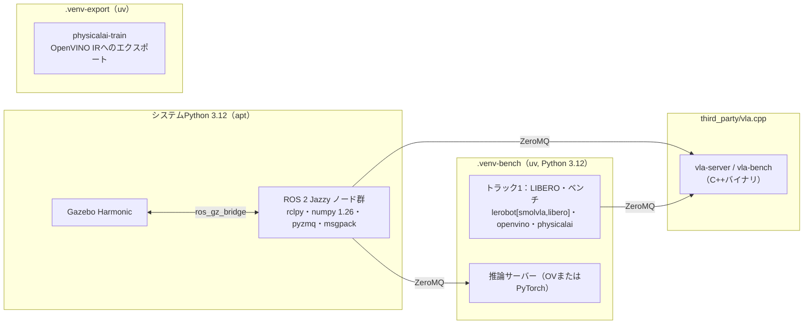

# 01. リポジトリ設計：構成・プロセス分離・データ形式

## 1. 目的と計画書の対応

- 実装を始める前に、**どこに何を置くか**、**どのプロセス・venvで何を動かすか**、**結果をどの形式で残すか**を決める。
- 計画書の対応箇所：「環境構成」「プロセス分離」「成果物」

この章の決めごとは、後続の全章が前提にします。

## 2. 前提知識・事前に読む資料

- uv：<https://docs.astral.sh/uv/>（`uv venv`、`uv pip`、`uv run`、`pyproject.toml` の依存定義）
- colconワークスペース：<https://docs.ros.org/en/jazzy/Tutorials/Beginner-Client-Libraries/Colcon-Tutorial.html>
- Python パッケージの `src` レイアウト：<https://packaging.python.org/en/latest/discussions/src-layout-vs-flat-layout/>

## 3. 成果物（最終的なディレクトリ構成）

```
edge_vla_research/
├── edge_vla_research_plan.md
├── docs/                         # このガイド＋自分の設計判断メモ（decisions.md）
├── pyproject.toml                # Pythonパッケージ evla の定義（ROS非依存部分）
├── src/evla/                     # ROSに依存しない共通コード（pytestで単体テストする）
│   ├── common/                   #   config.py, run_id.py, logging.py, paths.py, sysinfo.py
│   ├── policy/                   #   base.py, torch_policy.py, ov_policy.py, vlacpp_policy.py, factory.py
│   ├── bench/                    #   timing.py, mode_a.py, schema.py
│   ├── sim/                      #   libero_env.py, closed_loop.py, executor.py（同期/非同期）
│   ├── ipc/                      #   protocol.py, server.py, client.py（ZeroMQ）
│   ├── grasp/                    #   geometry.py, judge.py（把持判定の純粋関数）
│   ├── dataset/                  #   raw_episode.py, to_lerobot.py
│   └── analysis/                 #   stats.py, pareto.py, plots.py, load.py
├── scripts/                      # CLIエントリポイント（薄く保つ。中身は src/evla を呼ぶだけ）
├── configs/                      # 実験設定YAML（bench/, closed_loop/, sweep/, gazebo/）
├── tests/                        # pytest（src/evla のテスト）
├── third_party/                  # vla.cpp などの外部リポジトリ（git submodule か手動clone。.gitignore対象）
├── ros2_ws/
│   └── src/
│       ├── lerobot_ws/           # Ar-Ray-code/lerobot_ws（外部。変更はしない）
│       ├── evla_sim/             # ament_cmake：world, model, launch, bridge YAML, URDFオーバーレイ
│       └── evla_nodes/           # ament_python：grasp_judge, episode_runner, policy_node
├── results/                      # 実験結果（.gitignore対象。runs/<run_id>/ 単位）
├── data/                         # データセット・モデル（.gitignore対象）
└── reports/                      # 図表と報告書（gitで管理）
```

**【判断】** `src/evla` を ROS から独立した Python パッケージにする理由：

- 把持判定や統計処理などの**ロジックを、ROSを起動せずにpytestで検証できる**。
- ROS側（`evla_nodes`）は「メッセージを受けて `evla` の関数を呼び、結果をpublishする」だけの薄いラッパにする。
- ただし `evla` のうち ROS 側から import する部分（`grasp/`、`ipc/protocol.py`）は、**NumPy 1.26でも動くコードに限定する**（後述の依存制約）。

## 4. インタフェース仕様

### 4.1 プロセスとvenvの分離



| 環境 | Python | 主な依存 | 用途 |
| --- | --- | --- | --- |
| システム（ROS） | 3.12（Ubuntu 24.04のapt） | rclpy、numpy 1.26、`python3-zmq`、`python3-msgpack` | ROSノード（判定、記録、ポリシーノード） |
| `.venv-bench` | 3.12（uv） | `lerobot[smolvla,libero]`、`openvino`、`nncf`、`physicalai`、`pyzmq`、`protobuf`、`psutil`、`pandas`、`matplotlib` | トラック1全般、推論サーバー、データ変換 |
| `.venv-export` | 3.12（uv） | `physicalai-train[nncf]`（`lerobot==0.6.0` を固定で要求） | 学習済みSmolVLAのOpenVINO IRへの書き出し |
| vla.cpp | なし（C++） | libzmq、protobuf、（oneAPI / OpenVINO） | GGUF推論サーバー、`vla-bench` |
| 学習機（RTX PRO 6000） | 3.12 | `lerobot[smolvla]`（CUDA版torch） | ファインチューニング |

**依存の衝突は実在する**（調査で確認済み）。

- LeRobot 0.6系は `numpy>=2.0`、`requires-python>=3.12` を要求する。
- ROS 2 Jazzy の apt パッケージは Ubuntu 24.04 の NumPy 1.26 でビルドされている。venv に NumPy 2 を入れて rclpy を import すると、C拡張のABI不一致で落ちることがある。
- `physicalai-train 0.3.0` は `lerobot[dataset]==0.6.0` を固定で要求するため、最新のLeRobotと同じ venv に入れると解決に失敗しやすい。

→ **ROSノードの中では lerobot / torch / openvino を import しない**。これを全体のルールにする。

### 4.2 実験ID（run_id）と結果ディレクトリ

```
results/runs/<run_id>/
├── config.yaml          # 実行時の完全な設定（デフォルト値を展開した状態）
├── env.json             # 環境スナップショット（git commit、パッケージ版、CPU、スレッド設定など）
├── samples.parquet      # 生データ（1推論 = 1行、または1エピソード = 1行）
├── summary.json         # 集計値（p50 / p99 / 成功率など）
├── log.txt              # ログ
└── artifacts/           # 動画、図など
```

run_id の形式：`{YYYYmmdd-HHMMSS}_{track}_{mode}_{short-hash}`（例：`20261014-103012_t1_modeA_3fa9c1`）

- `short-hash` は**設定の内容から計算したハッシュ**にする（例：設定をキーでソートしてJSON化し、sha1の先頭6文字）。同じ設定を再実行したことが一目で分かる。

```python
# src/evla/common/run_id.py
def config_hash(cfg: Mapping[str, Any], n: int = 6) -> str:
    """設定辞書から決定的なハッシュを作る（キー順に依存しない）。"""

def new_run_id(track: str, mode: str, cfg: Mapping[str, Any]) -> str:
    """'20261014-103012_t1_modeA_3fa9c1' 形式のIDを返す。"""

def make_run_dir(run_id: str, root: Path = Path("results/runs")) -> Path:
    """ディレクトリを作成して返す。既存なら FileExistsError（上書き事故防止）。"""
```

### 4.3 環境スナップショット（env.json）

```python
# src/evla/common/sysinfo.py
@dataclass(frozen=True)
class EnvSnapshot:
    git_commit: str            # `git rev-parse HEAD`。未コミットの変更があれば末尾に "-dirty"
    hostname: str
    cpu_model: str             # /proc/cpuinfo の model name
    n_logical_cpus: int
    cpu_affinity: list[int]    # os.sched_getaffinity(0)
    mem_total_gb: float
    python: str
    packages: dict[str, str]   # torch, openvino, lerobot, numpy などの版（importlib.metadata）
    thread_env: dict[str, str] # OMP_NUM_THREADS, MKL_NUM_THREADS, VLA_N_THREADS など
    ov_devices: list[str]      # openvino.Core().available_devices（入っていれば）
    timestamp_utc: str

def capture_env() -> EnvSnapshot: ...
```

### 4.4 設定ファイル（YAML＋dataclass）

**【判断】** Hydra などの重いフレームワークは使わず、**dataclass＋YAML**で済ませる。理由：学習コストが小さく、型ヒントで補完が効き、設定ミスを起動時に検出できる。

```python
# src/evla/common/config.py
T = TypeVar("T")

def load_config(path: Path, cls: type[T], overrides: list[str] | None = None) -> T:
    """YAMLを読み、`a.b=3` 形式のoverridesを適用して、dataclass cls に変換する。
    未知のキーがあれば ValueError（タイポの早期検出）。"""

def dump_config(cfg: Any, path: Path) -> None:
    """dataclassをYAMLに書き出す（デフォルト値も含めて全部）。"""
```

### 4.5 結果データの形式

| データ | 形式 | 理由 |
| --- | --- | --- |
| 1推論ごとのレイテンシ | Parquet（pandas） | 列指向で小さく、型が保たれる。CSVのように数値が文字列化しない |
| エピソードごとの結果 | Parquet | 同上 |
| 設定・要約 | YAML / JSON | 人間が読める |
| 把持イベントのログ | JSON Lines（`.jsonl`） | 追記しやすく、途中で落ちても前の行が残る |
| 生エピソード（トラック2） | ディレクトリ＋PNG＋`.npz`＋JSON | ROS側（NumPy 1.26）で書ける。変換は別プロセス |

## 5. 実装手順

1. `.gitignore` に `results/`、`data/`、`third_party/`、`.venv*/`、`ros2_ws/{build,install,log}/` を追加する。
2. `pyproject.toml` を作り、`src/evla` をパッケージとして定義する（下の雛形を参照）。
3. `src/evla/common/` に `run_id.py`、`config.py`、`sysinfo.py`、`logging.py` を実装する。
4. `tests/common/` にこれらのテストを書く（ハッシュが決定的か、未知キーで例外になるか、など）。
5. `scripts/print_env.py` で `capture_env()` の結果を表示し、動作を確認する。
6. `docs/decisions.md` を作り、【判断】を変えた場合はここに記録する。

`pyproject.toml` の雛形（ロジックではなく設定なので載せる）：

```toml
[project]
name = "evla"
version = "0.1.0"
requires-python = ">=3.12"
dependencies = [
  "numpy",          # バージョンはvenv側で決まる（ROS側1.26 / bench側2.x の両方で動くコードにする）
  "pyyaml",
  "pyzmq",
  "msgpack",
]

[project.optional-dependencies]
bench = [
  # TODO(you): env/12 の手順で確定させたバージョンを固定する
  # "lerobot[smolvla,libero]==0.6.x", "openvino==2026.4.*", "physicalai==0.3.*",
  "pandas", "pyarrow", "matplotlib", "psutil",
]
dev = ["pytest", "ruff", "mypy"]

[build-system]
requires = ["hatchling"]
build-backend = "hatchling.build"

[tool.ruff]
line-length = 100
[tool.ruff.lint]
select = ["E", "F", "I", "B", "UP", "SIM", "NPY"]

[tool.pytest.ini_options]
testpaths = ["tests"]
```

## 6. ベストプラクティス

- **スクリプトは薄く、ロジックは `src/` に置く**：`scripts/*.py` は「引数を解析して `evla.xxx.run(cfg)` を呼ぶ」だけにする。ロジックがスクリプトにあるとテストも再利用もできない。
- **結果ディレクトリは上書きしない**：同じ run_id があれば例外にする。測定結果の取り違えは、研究では最悪の事故になる。
- **設定はすべてファイルに残す**：コマンドライン引数で上書きした値も含め、実際に使った値を `config.yaml` に書き出す。
- **生データを残し、集計は後で行う**：p50だけを保存すると、後からp99や外れ値を調べられない。1推論1行で残す。
- **外部リポジトリは変更しない**：lerobot_ws や vla.cpp に手を入れる必要が出たら、自分のパッケージ側でオーバーレイ（xacroのinclude、launchの引数）するか、パッチファイルとして残す。

## 7. 落とし穴

| 症状 | 原因 | 対処 |
| --- | --- | --- |
| ROSノードで `numpy.core.multiarray failed to import` | venvのNumPy 2をROSが読んだ | ROSノードはシステムPythonで動かす。`source .venv/bin/activate` したシェルで `ros2 run` しない |
| `/mnt/c/...` 上での作業が極端に遅い | WSL2のdrvfsは遅い | リポジトリは必ずLinux側（`~/...`）に置く（現在の配置で問題ない） |
| 結果を後から再現できない | 設定・環境が残っていない | `config.yaml` と `env.json` を必ず保存する |
| uvでtorchが数GBのCUDA版になる | LeRobotのpyprojectは、LinuxではCUDA 12.8のindexを指定している | bench側ではCPU版のindexを明示する（[env/12](env/12_inference_envs.md)） |

## 8. ヒント

<details><summary>L1：config_hash をどう作るか</summary>

辞書をJSONに変換するとき、キーの順序と浮動小数の表現を固定すれば、毎回同じバイト列になる。そのバイト列をハッシュ化する。
</details>

<details><summary>L2：使う標準ライブラリ</summary>

`json.dumps(..., sort_keys=True, separators=(",", ":"))`、`hashlib.sha1(...).hexdigest()`、`dataclasses.asdict`、`dataclasses.fields`（未知キーの検出）、`datetime.now().strftime(...)`、`subprocess.run(["git", "rev-parse", "HEAD"], ...)`、`git status --porcelain`（dirty判定）、`importlib.metadata.version`
</details>

<details><summary>L3：load_config の疑似コード</summary>

```
raw = yaml.safe_load(path)
for ov in overrides: key, value = ov.split("=", 1); raw[...ネストを辿る...] = yaml.safe_load(value)
return _from_dict(cls, raw)   # 再帰的に dataclass を構築
_from_dict(cls, d):
    known = {f.name for f in fields(cls)}
    unknown = d.keys() - known → あれば ValueError
    各fieldについて、型がdataclassなら再帰、そうでなければそのまま
```
</details>

## 9. 完了条件（DoD）

- [ ] `uv run pytest tests/common` が通る
- [ ] `uv run python scripts/print_env.py` で、git commit、CPU、スレッド関連の環境変数、パッケージ版が表示される
- [ ] 同じ設定から2回 `config_hash` を計算して一致し、値を1つ変えると変わる
- [ ] 既存の run_id で `make_run_dir` を呼ぶと例外になる

## 10. 理解度チェック・発展課題

- なぜROSノードとLeRobotを同じプロセスに入れてはいけないのか、ABIの観点から説明できるか。
- 1推論1行で保存した場合と、要約値だけを保存した場合とで、後から**できなくなる分析**を3つ挙げよ。
- 発展：`EnvSnapshot` に「計測開始時のCPU温度」を入れたい。WSL2からは取得できない。どう設計するか（ヒント：[40](common/40_metrics_measurement.md)）。
