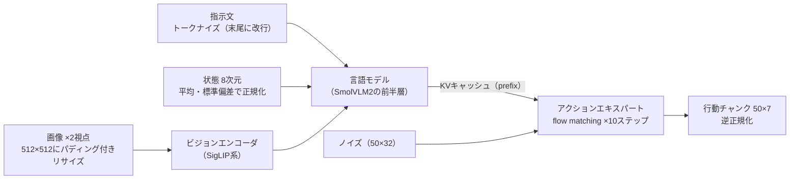
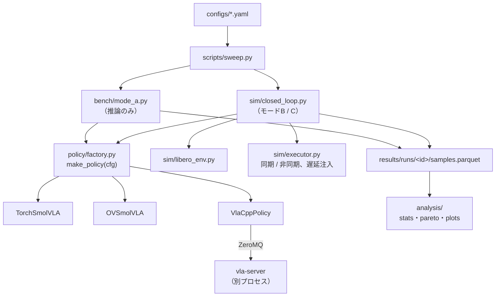

# track1/20. トラック1の全体像：LIBEROでのエッジ推論ベンチマーク

## 1. 目的と計画書の対応

- トラック1で作るもの全体の地図を示す。個々の実装は21〜28章で扱う。
- 計画書の対応箇所：「トラック1：LIBEROでのエッジ推論ベンチマーク」全体

**トラック1の問い**：i7-1360P（＋Iris Xe）で、SmolVLAを**どのランタイム・精度・入力条件で動かせば、何msで、LIBEROの成功率がどれだけ出るか**。

## 2. 前提知識・事前に読む資料

- SmolVLA論文：<https://arxiv.org/abs/2506.01844>（特に3章のアーキテクチャと、非同期推論の節）
- LIBERO（LeRobot版ドキュメント）：<https://huggingface.co/docs/lerobot/en/libero>
- vla.cppのベンチ結果：<https://github.com/VinRobotics/vla.cpp/tree/main/docs/benchmark>

### 2.1 SmolVLAの推論で何が起きているか（実装前に理解しておく）



| 段 | 公開値での目安（i7-14700F、vla.cpp CPU） | 掃引で効く軸 |
| --- | --- | --- |
| ビジョン | 約1.1秒（全体1.7秒のうち） | 解像度、視点数 |
| 言語モデル（prefix） | 残りの大半 | 精度（Q8_0 / Q4_0 / INT8） |
| アクションエキスパート | 10ステップ分 | `--num-steps`、精度 |

**ビジョン部が全体の6割以上**を占めるので、解像度と視点数の掃引が最も効くと予想できます。ただし、学習時（512px・2視点）と違う入力で推論すると、精度が落ちる可能性があります。これを成功率で確かめるのがトラック1の価値です。

### 2.2 公開値から見積もる、この端末でのレイテンシ

| 端末 | ランタイム | SmolVLA p50 |
| --- | --- | --- |
| RTX 5090 | vla.cpp CUDA | 38 ms |
| Jetson AGX Orin | vla.cpp CUDA | 218 ms |
| Jetson Orin Nano Super | vla.cpp CUDA | 463 ms |
| Intel Arc B390（iGPU、Panther Lake） | vla.cpp OpenVINO GPU | 500 ms |
| i7-14700F（デスクトップ、65W） | vla.cpp CPU | 1,690 ms |
| Core Ultra X7 358H（モバイル、25W） | vla.cpp CPU | 1,790 ms |
| **i7-1360P（本研究、28W級）** | ? | **2〜3秒程度と予想** |
| **Iris Xe（96EU）** | ? | **B390よりかなり遅いと予想** |

→ 30Hzでチャンク50の場合、1チャンクで稼げる時間は1.67秒です。**CPUでは同期実行だとロボットが止まる時間が長くなる**ので、非同期実行（27章）とチャンク長の効果が主な論点になります。

## 3. 成果物（トラック1全体）

| 章 | 成果物 | 中身 |
| --- | --- | --- |
| [21](21_libero_setup.md) | `src/evla/sim/libero_env.py` | LIBEROの薄いラッパ（観測の形式を統一する） |
| [22](22_policy_interface.md) | `src/evla/policy/base.py`、`factory.py` | ランタイム共通のPolicy抽象 |
| [23](23_runtime_pytorch.md) | `src/evla/policy/torch_policy.py` | LeRobotのSmolVLA（PyTorch CPU） |
| [24](24_runtime_openvino.md) | `src/evla/policy/ov_policy.py` | physicalaiのOpenVINO（CPU / GPU）、INT8 |
| [25](25_runtime_vlacpp.md) | `src/evla/policy/vlacpp_policy.py` | vla-serverのクライアント（CPU / SYCL / OV） |
| [26](26_bench_mode_a.md) | `src/evla/bench/`、`scripts/bench_mode_a.py` | 単体ベンチ |
| [27](27_closed_loop_b_c.md) | `src/evla/sim/closed_loop.py`、`executor.py` | 閉ループ評価（ロックステップ、リアルタイム） |
| [28](28_sweep_and_pareto.md) | `src/evla/analysis/`、`scripts/sweep.py` | 掃引、集計、パレート図 |

## 4. インタフェース仕様（モジュール間の関係）



### 4.1 測定モード

| モード | 内容 | 測るもの | 実装する章 |
| --- | --- | --- | --- |
| A：単体ベンチ | 固定の観測（LIBEROの実画像を保存したもの）で、推論だけを繰り返す | レイテンシの分布、メモリ | [26](26_bench_mode_a.md) |
| B：ロックステップ | 推論中はシミュレーションを止める | 遅延と切り離した成功率（量子化や解像度による精度劣化だけを見る） | [27](27_closed_loop_b_c.md) |
| C：リアルタイム | 推論中もシミュレーションが進む（実時間、または仮想時間で遅延を注入） | 遅延×チャンク長×同期/非同期 → 成功率 | [27](27_closed_loop_b_c.md) |

**【判断】** モードCは、主に**仮想時間方式**で行う。推論にかかった時間（または注入した遅延）を「その間に進むシミュレーションのステップ数」に換算する。

- 理由1：LIBERO（MuJoCo）は実時間で動くシミュレータではなく、壁時計で回すとMuJoCoの描画と推論がCPUを取り合って、測定値が汚れる（計画書のリスク表の1番目）。
- 理由2：遅延を正確に制御でき、再現性がある。
- 実時間方式は、確認用に1〜2設定だけ行う。

### 4.2 評価に使うLIBEROスイート

- **主：`libero_object`**（10タスク。物体を籠に入れるPick & Placeで、計画書のタスクに最も近い）。vla.cppのSmolVLA参照値は89.5%（200エピソード、チャンクから10行動を実行）。
- 余裕があれば `libero_spatial` を追加する。

## 5. 実装手順（トラック1の推奨順）

1. [21](21_libero_setup.md)：LIBEROを起動し、ランダム行動で1エピソード回して動画を保存する（D2）
2. [22](22_policy_interface.md)→[23](23_runtime_pytorch.md)：PyTorchのSmolVLAで1エピソード成功させる（D2）
3. [26](26_bench_mode_a.md)：モードAのベンチ基盤を作り、PyTorchのベースラインを測る（D2〜D3）
4. [24](24_runtime_openvino.md)、[25](25_runtime_vlacpp.md)：OVとvla.cppのアダプタを作り、モードAで測る（D3）
5. [28](28_sweep_and_pareto.md)：モードAの掃引（D4）
6. [27](27_closed_loop_b_c.md)：モードB（上位3設定、D5）→ モードC（D6〜D7）
7. [28](28_sweep_and_pareto.md)：パレート図（D7）

## 6. ベストプラクティス

- **まず1本を最後まで通す**：PyTorch × モードA × 1設定で、結果がParquetに保存され、集計スクリプトが図を出すところまでを最初に作る。その後でランタイムや設定を増やす。
- **数値の一致を先に確かめる**：OVやvla.cppを測る前に、同じ入力（固定ノイズ）に対してPyTorchと行動がどれだけ近いかを確認する（[22](22_policy_interface.md)）。前処理がずれていると、成功率の低下を量子化のせいだと誤解する。
- **計算資源の予算を見積もる**：モードBは、1エピソードあたり最大280ステップ、10ステップごとに推論すると約28回の推論になる。1回2.5秒なら約70秒で、50エピソードで約1時間かかる。掃引の組み合わせは、この予算から逆算して決める（[28](28_sweep_and_pareto.md)）。

## 7. 落とし穴

| 症状 | 原因 | 対処 |
| --- | --- | --- |
| どのランタイムでも成功率が0% | 画像の上下反転、カメラキーの名前違い、状態の次元違い | [21](21_libero_setup.md) と [22](22_policy_interface.md) の数値一致チェック |
| 成功率が報告値より10ポイント以上低い | `n_action_steps`（チャンクから何行動を実行するか）、`control_mode` の不一致 | vla.cppの参照設定（チャンクから10行動を実行）に合わせる |
| モードCの曲線がばらつきすぎる | エピソード数が少ない | 信頼区間を付け、必要な試行数を見積もる（[27](27_closed_loop_b_c.md)） |

## 8. ヒント

<details><summary>L1：最初の1日で何を目標にするか</summary>

「PyTorchのSmolVLAがLIBEROで1回成功する動画」と「同じ観測で20回推論した時間の表」の2つ。これができれば、残りはこの2つの横展開になる。
</details>

<details><summary>L2：既存コードで参考になるもの（コピーではなく読解用）</summary>

LeRobotの `src/lerobot/envs/libero.py`（観測の作り方）、`src/lerobot/scripts/lerobot_eval.py`（評価ループ）、vla.cppの `eval/client/vla_cpp_client.py`（`_predict_chunk` の前処理）、`eval/client/benchmark.py`
</details>

<details><summary>L3：全体の流れ（疑似コード）</summary>

```
policy = make_policy(cfg.policy)                # 22章
if cfg.mode == "A": run_mode_a(policy, fixed_obs, cfg.bench)      # 26章
else:
    env = make_libero_env(cfg.env)              # 21章
    executor = make_executor(cfg.executor)      # 27章（sync/async、遅延）
    for ep in episodes: run_episode(env, policy, executor)
save(results); summarize(results)               # 28章
```
</details>

## 9. 完了条件（DoD）

トラック1全体の完了条件（各章のDoDの総和）：

- [ ] 5つのランタイム（PyTorch CPU、OV CPU、OV GPU、vla.cpp CPU、vla.cpp SYCLまたはOV-GPU）について、モードAのレイテンシ表がある
- [ ] モードBで上位3設定の成功率（信頼区間付き）がある
- [ ] モードCで「遅延×チャンク長→成功率」の曲線と、同期と非同期の比較がある
- [ ] パレート図（レイテンシ対成功率）がある

## 10. 理解度チェック・発展課題

- SmolVLAが「チャンク50個を一度に出す」設計は、遅い推論に対してどう効くか。逆に何が悪くなるか。
- ビジョン部が支配的なら、視点を2から1に減らすと推論時間はおよそ何割減ると予想されるか。成功率への影響はどうか。
- 発展：flow matchingのステップ数（`--num-steps`）を10から5に減らすと、何が速くなり、何が悪化しうるか。
