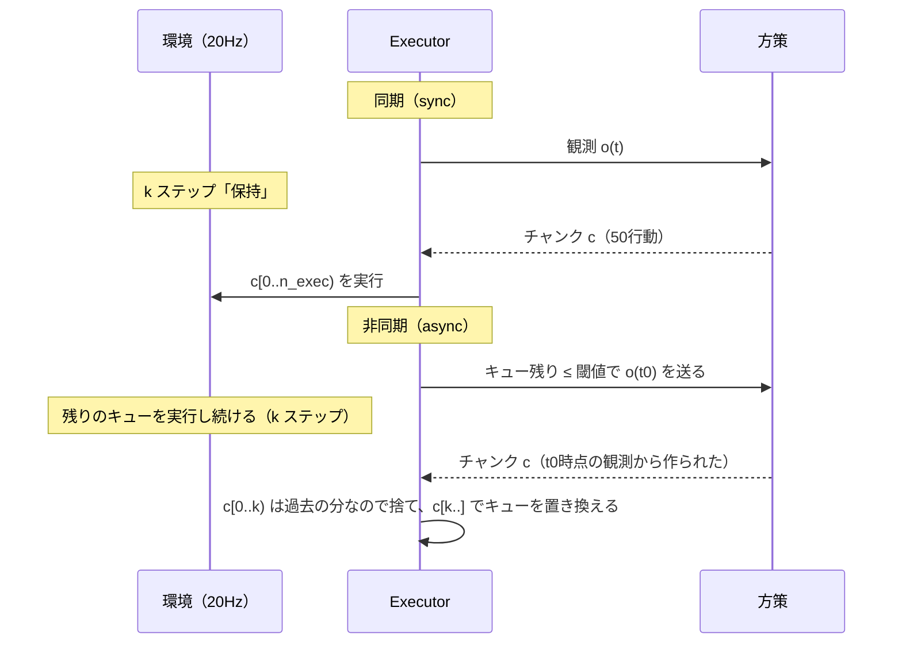

# track1/27. モードB・C：閉ループ評価（ロックステップ、リアルタイム、遅延注入、同期/非同期）

> **穴埋め版**（進め方は [03_fill_in_guide](../03_fill_in_guide.md)）
> - 埋めるファイル（穴の数）：`src/evla/sim/latency.py`（2）、`src/evla/sim/executor.py`（7）、`src/evla/sim/closed_loop.py`（2）、`src/evla/analysis/stats.py`（7）、`scripts/eval_closed_loop.py`（1）
> - テスト：`pytest tests/sim tests/analysis/test_stats.py`
> - 「5. 実装手順」は、ゼロから書く場合の手順です。穴埋め版では、手順の中の**確認作業**（動作確認・測定・完了条件）を行い、コードは穴を埋めるだけで足ります。

## 1. 目的と計画書の対応

- LIBEROで成功率を測る閉ループ評価器を作る。
- 推論遅延とアクションチャンクの扱い（同期 / 非同期）を、**executor** として方策から切り離して実装する。
- 「許容遅延×チャンク長→成功率」の曲線と、同期と非同期の比較を出せるようにする。
- 計画書の対応箇所：トラック1「測定モードB / C」「遅延注入」「同期推論と非同期推論の比較」、日程D5〜D7、成果物「遅延許容曲線」

## 2. 前提知識・事前に読む資料

- SmolVLA論文の非同期推論の節（チャンクの閾値 g と、重なり部分の集約）
- LeRobotの非同期推論：<https://huggingface.co/docs/lerobot/en/async>（`actions_per_chunk`、`chunk_size_threshold`、`aggregate_fn_name`）
- Real-Time Chunking（RTC）：Black et al. 2025, "Real-Time Execution of Action Chunking Flow Policies"（発展課題で使う）
- 二項比率の信頼区間（Wilson）と、対応のある比較（McNemar検定）

## 3. 成果物

| パス | 役割 |
| --- | --- |
| `src/evla/sim/latency.py` | 遅延モデル（実測、一定値、分布からのサンプル） |
| `src/evla/sim/executor.py` | `SyncExecutor`、`AsyncExecutor`（仮想時間方式） |
| `src/evla/sim/closed_loop.py` | `run_episode()`、`run_eval(cfg)` |
| `src/evla/sim/realtime.py` | 壁時計方式（確認用。1〜2設定だけ使う） |
| `src/evla/analysis/stats.py` | `wilson_ci`、`mcnemar`、`required_n` |
| `scripts/eval_closed_loop.py` | CLI |
| `configs/closed_loop/*.yaml` | モードB、モードC（同期 / 非同期）の設定例 |
| `tests/sim/test_executor.py` | **偽の環境と偽の方策**で、executorのタイミングを検証するテスト |

## 4. インタフェース仕様

### 4.1 時間の考え方（仮想時間方式）

- 環境の1ステップ＝ Δ = 1 / `control_freq` = 50 ms（LIBEROは20Hz）。
- 推論に L 秒かかるとき、その間に環境は **k = ceil(L / Δ)** ステップ進む。
- **モードB（ロックステップ）**：k = 0 とみなす。推論中は環境を止める。
- **モードC**：k ステップの間、ロボットは何かをしなければならない。何をするかが同期と非同期の違い。



### 4.2 インタフェース

```python
# src/evla/sim/latency.py
class LatencyModel(Protocol):
    def sample(self, measured_ms: float, rng: np.random.Generator) -> float:
        """今回の推論について、シミュレーション上で経過したとみなす遅延[ms]を返す。"""

@dataclass(frozen=True)
class MeasuredLatency:       # 実測値をそのまま使う（scale で端末差を模擬してもよい）
    scale: float = 1.0
    add_ms: float = 0.0

@dataclass(frozen=True)
class ConstantLatency:       # 実測値を無視して一定値（遅延許容曲線の主役）
    ms: float

@dataclass(frozen=True)
class EmpiricalLatency:      # モードAの samples.parquet から分布をリサンプリングする（ジッタも再現）
    samples_ms: tuple[float, ...]
```

```python
# src/evla/sim/executor.py
@dataclass(frozen=True)
class ExecutorConfig:
    mode: Literal["lockstep", "sync", "async"]
    n_exec: int = 10                  # 1チャンクから実行する行動数（実行ホライズン）
    async_threshold: int = 5          # 非同期：キューの残りがこれ以下になったら次を推論する
    hold_action: Literal["zero", "last"] = "zero"   # 行動がないときに送るもの
    control_hz: float = 20.0

@dataclass
class EpisodeTrace:                   # 1エピソードの記録（Parquetに1ステップ1行で保存してもよい）
    steps: int = 0
    n_inferences: int = 0
    hold_steps: int = 0               # 行動がなく保持したステップ数（同期では毎回、非同期ではキュー枯渇時）
    discarded_actions: int = 0        # 非同期で、到着時に古くなって捨てた行動の数
    latencies_ms: list[float] = field(default_factory=list)       # 実測
    sim_latencies_ms: list[float] = field(default_factory=list)   # 遅延モデルが返した値

class Executor(ABC):
    def __init__(self, cfg: ExecutorConfig, policy: Policy, latency: LatencyModel, rng: np.random.Generator): ...
    @abstractmethod
    def run(self, env: "StepEnv", first_obs: Observation, max_steps: int) -> tuple[bool, EpisodeTrace]:
        """エピソードを最後まで回し、(成功したか, 記録) を返す。"""
```

`StepEnv` は `step(action) -> StepResult` を持つ最小のProtocolにします。これによって、**LIBEROなしで、偽の環境（ステップ数を数えるだけ）を使ってexecutorのタイミングをテストできます**。

```python
# src/evla/sim/closed_loop.py
@dataclass(frozen=True)
class ClosedLoopConfig:
    policy: PolicyConfig
    executor: ExecutorConfig
    latency: Mapping[str, Any]          # {"type": "constant", "ms": 500} など
    suite: str = "libero_object"
    task_ids: tuple[int, ...] = tuple(range(10))
    episodes_per_task: int = 5          # init_state_index 0..4 を使う（全設定で共通の集合）
    seed: int = 0
    save_video: Literal["none", "failures", "all"] = "failures"

def run_eval(cfg: ClosedLoopConfig, run_dir: Path) -> pd.DataFrame:
    """1エピソード＝1行のDataFrameを返し、run_dir/episodes.parquet に保存する。
    列：task_id, init_state_index, success, steps, n_inferences, hold_steps, discarded_actions,
        lat_p50_ms, sim_lat_p50_ms, wall_s"""
```

```python
# src/evla/analysis/stats.py
def wilson_ci(k: int, n: int, alpha: float = 0.05) -> tuple[float, float]: ...
def mcnemar(a_success: Sequence[bool], b_success: Sequence[bool]) -> dict[str, float]:
    """同じ (task, init_state) の組で比較した、対応のある検定。b01, b10, p値（正確二項検定）。"""
def required_n(p1: float, p2: float, alpha: float = 0.05, power: float = 0.8) -> int:
    """2群の比率の差を検出するのに必要な1群あたりの試行数（正規近似）。"""
```

## 5. 実装手順

1. **偽の環境と偽の方策を作る（1時間）**：`tests/sim/fakes.py`。偽の方策はチャンクの各行動に「何番目の推論の、何番目の行動か」を埋め込む。偽の環境は受け取った行動を全部記録する。
2. **`SyncExecutor`（1.5時間）**
   - ループ：推論 → `k = ceil(L / Δ)` 回 `hold` を送る（lockstepなら0回）→ チャンクの先頭 `n_exec` 個を実行 → 繰り返す。
   - 推論のための観測は、**推論を始めた時点**の観測。保持中の観測は使わない。
3. **`AsyncExecutor`（2〜3時間）**：この章で最も難しいところ。
   - キューを持つ。最初は同期で1回推論してキューを満たす。
   - 各ステップで、キューの残り ≤ `async_threshold` かつ推論中でなければ、現在の観測で推論を「開始」する。推論は仮想時間で k ステップ後に「到着」する。
   - 到着までは、キューの行動を実行し続ける。キューが空なら `hold`（`hold_steps` を数える）。
   - 到着したら、新しいチャンクの先頭 k 個を捨て（その時刻はもう過ぎた）、`c[k : k + n_exec]` でキューを**置き換える**。
   - 仮想時間方式なので、推論は実際には「開始」の時点で同期的に計算してしまってよい。結果を k ステップ後まで保留しておけばよい。**実際の並列実行は不要**で、それが再現性の源になる。
4. **テスト（1.5時間）**：偽の環境で次を確かめる。
   - lockstep：`hold_steps == 0`、実行された行動が チャンク0の0〜9 → チャンク1の0〜9 …
   - sync, L=150ms（k=3）：各チャンクの前に hold が3つ入る
   - async, L=150ms, threshold=5：hold が0、チャンクの切り替わりで先頭3つが捨てられる
   - async, Lが非常に大きい：キューが枯れて hold が発生する
5. **`run_eval`（2時間）**：21章の環境、22章の方策、executorをつなぐ。エピソードごとに方策のノイズのシードを `hash((seed, task, init_state))` から決める。
6. **モードBの実行（D5）**：上位3設定（28章）× `libero_object` 10タスク × 5エピソード。
7. **モードCの実行（D6〜D7）**：6節の計画に従う。
8. **壁時計方式での確認（任意、2時間）**：環境のステップを20Hzのタイマーで回すスレッドと、推論するスレッド（またはvla-serverへの非同期リクエスト）を分けて、1設定だけ実行する。仮想時間方式の結果と矛盾しないことを確かめる。

## 6. ベストプラクティス

### 6.1 モードCの実験計画

| 実験 | 変える軸 | 固定するもの |
| --- | --- | --- |
| 遅延許容曲線 | 遅延 d ∈ {0, 0.1, 0.25, 0.5, 1.0, 1.5, 2.0, 3.0} 秒 × n_exec ∈ {5, 10, 25, 50} | モデルと精度（例：PyTorch FP32）、同期 |
| 同期と非同期 | sync / async × d ∈ {0.5, 1.0, 2.0, 実測分布} | n_exec=25、threshold を2水準 |
| 実機相当 | `EmpiricalLatency`（モードAで選んだ設定の実測分布） | 選んだ設定 |

- **遅延許容曲線では、推論の実際の速さは結果に影響しない**（遅延は `ConstantLatency` で与える）。したがって、数値が同じなら**最も速いランタイムで回してよい**。予算が大幅に減る。ただし、精度（量子化）を変えると行動が変わるので、精度は固定する。
- 1設定＝50エピソード（10タスク×5）を基本にする。曲線の32点×50＝1,600エピソード。1エピソード約1分なら約27時間かかる → **一晩×2回か、点を間引く**。予算は28章で再計算する。

### 6.2 統計

- **同じ (task, init_state) の組を全設定で使う**。こうすると、設定どうしを**対応のある比較**（McNemar）にでき、少ない試行数で差を検出できる。
- 成功率には必ずWilsonの95%信頼区間を付ける。目安：n=50、p=0.7 で約 [0.56, 0.81]。
- `required_n(0.9, 0.75)` のように、検出したい差に必要な試行数を事前に計算し、計画に書く。

### 6.3 実装

- **executorは方策を知らない、方策はexecutorを知らない**：22章で `Policy` を状態なしにしたのは、このため。
- **捨てた行動と保持したステップを数える**：成功率の違いを説明する材料になる（「非同期が勝ったのは、hold が減ったから」と言える）。
- **失敗した動画を保存する**：失敗の仕方（届かない、掴み損ねる、落とす、止まる）を分類すると、報告書の考察が書ける。

## 7. 落とし穴

| 症状 | 原因 | 対処 |
| --- | --- | --- |
| 非同期の成功率が同期より大きく悪い | 到着時に先頭 k 個を捨てていない（過去の行動を今実行している） | テストで捨てた数を確認する |
| lockstepの成功率が報告値（約90%）よりずっと低い | n_exec、`control_mode`、前処理の違い | まず n_exec=10（vla.cppの参照設定）で再現を確認する |
| `hold` で腕が下がっていく | relative制御で0を送っても、重力補償の誤差でずれる | `hold_action="zero"` と `"last"` を比べ、どちらが保持として妥当か確かめて記録する |
| 実行時間が予算を大幅に超える | 失敗したエピソードが最大ステップまで走る | 予算は「全エピソードが最大ステップまで走る」と仮定して見積もる |
| 設定間の差が信頼区間の中に収まる | 試行数不足 | `required_n` で必要数を計算し、点を減らして試行数を増やす |

## 8. ヒント

<details><summary>L1：非同期を仮想時間でどう表すか</summary>

「推論中」という状態を、「到着予定のステップ番号」と「到着するチャンク」の組で表す。毎ステップ、現在のステップ番号が到着予定に達したかどうかだけを確かめればよい。スレッドは要らない。
</details>

<details><summary>L2：使うデータ構造と関数</summary>

`collections.deque`（キュー）、`math.ceil`、`dataclasses.replace`、`scipy.stats.binomtest`（McNemarの正確検定）、`statsmodels.stats.proportion.proportion_confint(method="wilson")`（自作したら答え合わせに使う）
</details>

<details><summary>L3：AsyncExecutor.run の疑似コード</summary>

```
queue = deque(first_chunk[:n_exec]); pending = None  # (arrive_step, chunk)
obs = first_obs; t = 0
while t < max_steps:
    if pending is None and len(queue) <= thr:
        r = policy.predict_chunk(obs); L = latency.sample(r.latency_ms, rng)
        k = ceil(L / dt); pending = (t + k, r.actions, k)
    if pending is not None and t >= pending[0]:
        _, c, k = pending; queue = deque(c[k:k + n_exec]); discarded += k; pending = None
    a = queue.popleft() if queue else hold()
    res = env.step(a); obs = res.obs; t += 1
    if res.done: return res.success, trace
return False, trace
```

（k が `n_exec` 以上になると、`c[k:k+n_exec]` が空になりうる。その場合の扱いを決めてテストする）
</details>

## 9. 完了条件（DoD）

- [ ] `pytest tests/sim/test_executor.py` が通る（4節の4ケース以上）
- [ ] モードBで、PyTorch FP32、n_exec=10 の `libero_object` の成功率（信頼区間付き）があり、参照値（約90%）と比較した
- [ ] モードBで上位3設定の成功率がある（D5）
- [ ] 遅延許容曲線（遅延×n_exec→成功率、信頼区間の帯付き）の図がある（D6）
- [ ] 同期と非同期の比較表（成功率、hold_steps、discarded_actions）がある（D7）
- [ ] 壁時計方式の確認を行った、または行わなかった理由を記録した

## 10. 理解度チェック・発展課題

- 非同期で `async_threshold` を大きくすると、何が良くなり、何が悪くなるか（LeRobotの `chunk_size_threshold` の説明と対応づけよ）。
- 遅延 d が n_exec × Δ より大きいとき、同期と非同期でそれぞれ何が起きるか。
- 発展：新旧チャンクの重なり部分を、置き換えではなく重み付き平均で滑らかにつなぐ（LeRobotの `weighted_average`）。成功率と、行動の滑らかさ（隣接行動の差のノルム）の両方で比較せよ。さらに余裕があれば、RTC（推論時に過去の行動へのガイダンスをかける）を調べ、SmolVLAの `inference.type=rtc` と比べよ。
