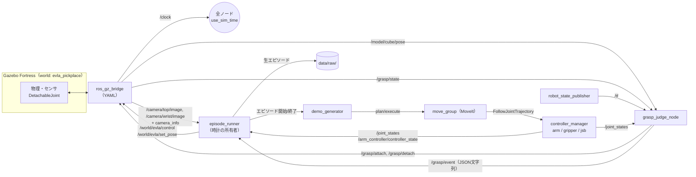
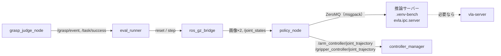

# track2/30. トラック2の全体像：ROSグラフとプロセス境界

> **ハンズオンの地図**（共通の進め方は [03_fill_in_guide](../03_fill_in_guide.md)）
> - この章に穴埋めはありません。トラック2の各章（31〜38）のハンズオンを、どの順で進めるかと、ROS グラフの全体像を押さえる章です
> - 5節の表の「ゴール」が、各章の最後のチェックで確かめられたら次の章へ進みます

## 1. 目的と計画書の対応

- トラック2の構成（ノード、トピック、サービス、プロセス、時間の基準）を先に決める。個々の実装は31〜38章で扱う。
- 計画書の対応箇所：「トラック2：Gazebo統合とデータセット設計」「ポリシー実行の構成」「プロセス分離」「把持判定仕様」

## 2. 前提知識・事前に読む資料

- [env/11](../env/11_ros2_gazebo.md) の lerobot_ws の事実（関節名 "1"〜"6"、`update_rate` 10Hz、5自由度）
- ros_gz_bridge：<https://github.com/gazebosim/ros_gz/tree/humble/ros_gz_bridge>
- Gazeboの時間制御（WorldControl）：<https://gazebosim.org/api/gazebo/6/>（`/world/<name>/control` サービス）

## 3. 成果物（トラック2全体）

| 章 | 成果物 | 中身 |
| --- | --- | --- |
| [31](31_gazebo_scene.md) | `ros2_ws/src/evla_sim/` | world、物体、カメラ、TCP、DetachableJoint、bridge、launch |
| [32](32_grasp_judge_node.md) | `src/evla/grasp/`、`evla_nodes/grasp_judge_node.py` | 把持判定（純粋関数）とROSノード |
| [33](33_moveit_demo_gen.md) | `evla_nodes/demo_generator.py` | MoveItでのpick&placeと、ランダム化 |
| [34](34_episode_recorder.md) | `evla_nodes/episode_runner.py`、`src/evla/dataset/` | ロックステップでの記録と、LeRobotDataset v3への変換 |
| [35](35_finetune_smolvla.md) | 学習の設定と記録 | RTX PRO 6000でのファインチューニング |
| [36](36_model_conversion.md) | 変換スクリプト | OpenVINO IR / GGUF |
| [37](37_policy_node_zmq.md) | `src/evla/ipc/`、`evla_nodes/policy_node.py` | 推論サーバーとROSポリシーノード |
| [38](38_gazebo_eval.md) | 評価スクリプト | 閉ループ評価、閾値の感度分析 |

## 4. インタフェース仕様

### 4.1 ROSグラフ（データ生成時）



### 4.2 ROSグラフ（評価時）



### 4.3 プロセスと環境の境界

| プロセス | Python | 備考 |
| --- | --- | --- |
| `ign gazebo`、bridge、controller、move_group、自作ノード | システム（ROS） | lerobot / torch / transformers は import しない |
| 推論サーバー `evla.ipc.server` | `.venv-bench` | 22章の `Policy` をそのまま使う（torch / ov / vlacpp） |
| `vla-server` | なし（C++） | vlacpp を使う場合だけ。推論サーバーの裏で動く |
| 生エピソード → LeRobotDataset の変換 | `.venv-bench` | オフラインのバッチ処理（34章） |

**【判断】** ポリシーノードは vla-server に直接つながず、**自作の推論サーバーを経由**する。

- 理由1：vla-serverのSmolVLAは、**クライアント側でのトークン化（transformers）**と前処理を前提にしている。ROSのプロセスでは transformers を使えない。
- 理由2：推論サーバーが `Policy` 抽象を使えば、トラック1で選んだどのランタイムにも同じ手順で切り替えられる。
- 代償：vlacppの場合、ローカルの通信が1段増える。増えた時間は `breakdown_ms` で分けて測る。

### 4.4 時間の基準

| 項目 | 値（【判断】） | 理由 |
| --- | --- | --- |
| 物理ステップ | 1/600 秒（≈1.667ms） | 30Hzのフレームが整数ステップ（20ステップ）になる。既定の1msでは 1/30秒＝33.3ステップで割り切れない |
| コントローラ周期（`update_rate`） | 300 Hz | 物理の約数、かつ30Hzの倍数。lerobot_wsの既定10Hzでは軌道がガタつく |
| カメラ | 30 Hz（sim時刻） | 公開SO-101データと同じ |
| 記録とポリシー | 30 Hz（sim時刻） | 同上 |
| 時計の所有者 | データ生成時は `episode_runner`、評価時は `eval_runner`（またはlockstep時の `policy_node`） | world の pause / step を呼ぶのは1つのノードだけにする（競合を防ぐ） |

### 4.5 トピック・サービス一覧

| 名前 | 型 | 向き | 用途 |
| --- | --- | --- | --- |
| `/clock` | `rosgraph_msgs/Clock` | GZ→ROS | sim時刻 |
| `/camera/{top,wrist}/image` | `sensor_msgs/Image` | GZ→ROS | 480×640 RGB |
| `/camera/{top,wrist}/camera_info` | `sensor_msgs/CameraInfo` | GZ→ROS | 内部パラメータ |
| `/model/cube/pose` | `tf2_msgs/TFMessage`（GZは `Pose_V`） | GZ→ROS | キューブの真の姿勢（**【要確認】** 31章で方式を決める） |
| `/grasp/attach`、`/grasp/detach` | `std_msgs/Empty` | ROS→GZ | DetachableJointの操作 |
| `/grasp/state` | `std_msgs/String`（GZは `StringMsg`） | GZ→ROS | `"attached"` / `"detached"` |
| `/grasp/event` | `std_msgs/String`（JSON） | ROS | 把持・解放・成功のイベント |
| `/world/evla/control` | `ros_gz_interfaces/srv/ControlWorld` | ROS→GZ | pause / step / multi_step |
| `/world/evla/set_pose` | `ros_gz_interfaces/srv/SetEntityPose` | ROS→GZ | キューブ・箱の再配置 |
| `/arm_controller/joint_trajectory` | `trajectory_msgs/JointTrajectory` | ROS | ポリシーの指令（評価時） |
| `/arm_controller/follow_joint_trajectory` | action | ROS | MoveItの実行（生成時） |

## 5. ハンズオンの進め方（トラック2の推奨順）

| 順 | 章 | 穴 | ハンズオンのゴール | 日 |
| --- | --- | --- | --- | --- |
| 1 | [31](31_gazebo_scene.md) | 16 | launch 1本でシーン・カメラ・bridge が起動し、attach / detach を操作できる | D2 |
| 2 | [32](32_grasp_judge_node.md) | 33 | `pytest tests/grasp` が通り、Gazebo で attach の可否が判定される | D3 |
| 3 | [33](33_moveit_demo_gen.md) | 18 | `pytest tests/planning` が通り、固定配置の pick & place が1回成功する → ランダム化 | D3〜D4 |
| 4 | [34](34_episode_recorder.md) | 36 | ロックステップで記録・変換でき、一晩でデータセットを作る | D3〜D4 |
| 5 | **D5判定ゲート** | — | [00_schedule](../00_schedule.md) の基準で、学習に進むかを決める | D5 |
| 6 | [35](35_finetune_smolvla.md) | 0 | 学習機で SmolVLA をファインチューニングし、エッジで読み込める | D5〜 |
| 7 | [37](37_policy_node_zmq.md) | 21 | `pytest tests/ipc` が通り、まず LIBERO のモデルでループが回る | D6〜D7 |
| 8 | [36](36_model_conversion.md)、[38](38_gazebo_eval.md) | 4＋6 | 変換したモデルで Gazebo の評価を回し、成功率と感度曲線を出す | D8 |

ROS ノードの章（31・32・33・34・37・38）は、**ROS なしで確かめられる部分（`src/evla/` の純粋関数と pytest）を先に**、ROS 側（`ros2_ws/`、`source scripts/ros_env.sh`）を後に進める順で Step を並べています。

## 6. ベストプラクティス

- **時計の所有者は1つ**：pause / stepを複数のノードが呼ぶと、時間が予測不能になる。
- **launchを2つに分ける**：`sim.launch.py`（Gazebo、bridge、コントローラ、判定ノード）と、`datagen.launch.py` / `eval.launch.py`（目的別のノード）。シミュレーションを立ち上げたまま、目的別のノードだけを再起動できる。
- **トピック名はlaunchのremapで合わせる**：ノードの中には相対名（`image`）を書き、launchで絶対名にremapする。再利用しやすくなる。
- **イベントはJSON文字列で始める**：自作のメッセージ型（`.msg`）は、インタフェースパッケージのビルドが必要で、変更のたびに手間がかかる。仕様が固まってから型にすればよい。

## 7. 落とし穴

| 症状 | 原因 | 対処 |
| --- | --- | --- |
| ノードごとに時刻がずれる | `use_sim_time` の設定漏れ | launchで全ノードに一括で設定する |
| 画像と関節状態のタイムスタンプが合わない | 非同期のpublishを、到着順で組み合わせた | ロックステップ（34章）で、同じsim時刻のメッセージだけを集める |
| 推論サーバーとROSでNumPyのABIエラー | 同じプロセスで両方をimportした | 4.3の境界を守る |

## 8. ヒント

<details><summary>L1：グラフが正しく組めたか確かめるには</summary>

全ノードを起動して、`rqt_graph` で図を見る。上の図と比べ、矢印の欠けや余計なつながりを探す。
</details>

<details><summary>L2：使うコマンド</summary>

`ros2 node list`、`ros2 topic info -v <topic>`（QoSの不一致を確認）、`ros2 service list -t`、`ign topic -l`、`ign service -l`、`rqt_graph`
</details>

<details><summary>L3：sim.launch.py の構成（疑似コード）</summary>

```
DeclareLaunchArgument("world", default=evla_sim/worlds/evla_pickplace.sdf)
SetEnvironmentVariable(GZ_SIM_RESOURCE_PATH, [lerobot_description の親, evla_sim/models])   # Fortress は IGN_GAZEBO_RESOURCE_PATH も見る
IncludeLaunchDescription(ros_gz_sim/gz_sim.launch.py, gz_args="-r -v 3 <world>")   # 生成時は -r を外して停止状態で開始
Node(robot_state_publisher, params={robot_description: xacro(evla_sim/urdf/so101_evla.urdf.xacro), use_sim_time: True})
Node(ros_gz_sim create -topic robot_description -name so101)
Node(ros_gz_bridge parameter_bridge, params={config_file: evla_sim/config/bridge.yaml})
TimerAction/OnProcessExit → spawner joint_state_broadcaster → arm_controller → gripper_controller
Node(evla_nodes grasp_judge_node, params=[evla_sim/config/grasp.yaml, {use_sim_time: True}])
```
</details>

## 9. 完了条件（DoD）

- [ ] 4.1と4.2の図を、自分の実装に合わせて更新した（名前が違えば直す）
- [ ] 4.4の時間の設定値を決め、`docs/decisions.md` に記録した
- [ ] トラック2の完了時に、`rqt_graph` のスクリーンショットが `reports/` にある

## 10. 理解度チェック・発展課題

- 時計の所有者が2つあると、何が起きるか。具体的な失敗のシナリオを書け。
- ポリシーノードがvla-serverに直接つなぐ構成と比べて、推論サーバーを挟む構成の長所と短所は何か。
- 発展：評価時に、推論サーバーを別のマシン（外部推論）に置く構成に変えるには、何を変えればよいか（→ [41](../common/41_analysis_reporting.md) のtc netemの実験）。
