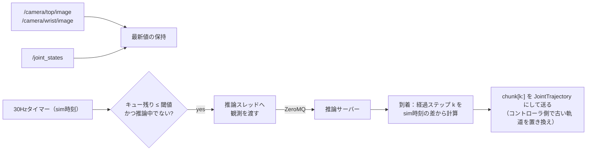

# track2/37. ROS 2ポリシーノードとZeroMQ IPC

> **ハンズオン**（共通の進め方は [03_fill_in_guide](../03_fill_in_guide.md)）
> - この章で埋める穴：**21個**（`src/evla/ipc/` の `protocol.py` 6、`client.py` 4、`server.py` 4、`scripts/serve_policy.py` 1、`ros2_ws/src/evla_nodes/evla_nodes/` の `action_mapping.py` 3、`policy_node.py` 3）
> - ゴール：`pytest tests/ipc` が通り、Gazebo 上でポリシーノード →（ZeroMQ）→ 推論サーバーのループが回って、RTT・実効制御周期・キュー枯渇が記録される
> - 進め方：Step 1〜2 は pytest とシェル2つ（`.venv-bench` とシステム Python）でできる。Step 3 以降は ROS 側

## 1. 目的と計画書の対応

- ROS（システムPython）と推論（`.venv-bench`）を**別プロセス**に分け、ZeroMQでつなぐ。
- カメラトピック → 推論サーバー → アクションチャンク → JointTrajectoryController、の経路を作る。
- 同期 / 非同期、ロックステップ / 実時間の両方で動かせるようにする。
- 計画書の対応箇所：「プロセス分離」「ポリシー実行の構成」、日程D6「ROS 2ポリシーノード実装」、D7「Gazebo閉ループの疎通確認」、成果物「ROS 2ポリシーノード」

## 2. 前提知識・事前に読む資料

- ZeroMQガイド：<https://zguide.zeromq.org/>（1章：REQ/REP、2章：マルチパート、ゼロコピー、4章：Lazy Pirate）
- pyzmqのゼロコピー送信：<https://pyzmq.readthedocs.io/en/latest/howto/serialization.html>
- msgpack：<https://github.com/msgpack/msgpack-python>
- JointTrajectoryControllerの軌道の置き換え：<https://control.ros.org/jazzy/doc/ros2_controllers/joint_trajectory_controller/doc/trajectory.html>
- 27章のexecutor（同期 / 非同期、古い行動の破棄）

## 3. 成果物

| パス | 役割 |
| --- | --- |
| `src/evla/ipc/protocol.py` | メッセージの定義とエンコード（**NumPy 1.26でも2でも動く**こと） |
| `src/evla/ipc/client.py` | `InferenceClient`（タイムアウトと再接続つき） |
| `src/evla/ipc/server.py` | `InferenceServer`：22章の `Policy` を包む（`.venv-bench` で動かす） |
| `scripts/serve_policy.py` | サーバーの起動CLI（`--config configs/policy/so101_ov_cpu.yaml` など。SO-101 用の設定ファイルは36章 Step 5 で自分で作る） |
| `evla_nodes/policy_node.py` | 実時間モードのポリシーノード |
| `evla_nodes/eval_runner.py` | 評価のエピソード管理。ロックステップのときは時計の所有者として推論ループも回す（38章） |
| `evla_nodes/action_mapping.py` | 方策の出力（度、LeRobotの順序）→ コントローラの指令（rad、URDFの関節名） |
| `tests/ipc/test_protocol.py`、`test_roundtrip.py` | エンコードの往復、サーバーとクライアントの往復 |

## 4. インタフェース仕様

### 4.1 プロトコル

**【判断】** REQ/REP＋マルチパートにする。1フレーム目はmsgpackのヘッダ、2フレーム目以降は配列の生のバイト列。

| フレーム | 内容 |
| --- | --- |
| 0 | msgpack：`{"v": 1, "type": "predict", "id": 123, "task": "...", "arrays": [{"name": "top", "dtype": "uint8", "shape": [480, 640, 3]}, ...], "noise_seed": null, "t_obs_sim": 12.3, "t_send_wall_ns": ...}` |
| 1..N | `arrays` の順に、各配列の `tobytes()`（C連続） |

応答：フレーム0に `{"v": 1, "type": "result", "id": 123, "arrays": [{"name": "actions", ...}], "latency_ms": ..., "breakdown_ms": {...}, "error": null}`、フレーム1に行動チャンク（float32 (50, 6)）。

その他の `type`：`ping`（死活確認）、`describe`（サーバー側の `Policy.describe()`）、`warmup`。

```python
# src/evla/ipc/protocol.py
PROTOCOL_VERSION = 1

def encode(header: dict[str, Any], arrays: Mapping[str, np.ndarray]) -> list[bytes | memoryview]:
    """ヘッダに配列のメタ情報を足して msgpack 化し、[header, buf1, buf2, ...] を返す。
    配列は C 連続にしてから memoryview で渡す（コピーを避ける）。"""

def decode(frames: Sequence[bytes | zmq.Frame]) -> tuple[dict[str, Any], dict[str, np.ndarray]]:
    """np.frombuffer(...).reshape(shape)。v が違えば ValueError。"""
```

```python
# src/evla/ipc/client.py
class InferenceClient:
    def __init__(self, addr: str, timeout_ms: int = 10_000, retries: int = 1) -> None: ...
    def predict(self, images: Mapping[str, np.ndarray], state: np.ndarray, task: str,
                t_obs_sim: float, noise_seed: int | None = None) -> "PredictReply":
        """タイムアウトしたらソケットを作り直し（Lazy Pirate）、retries 回まで再送する。それでも駄目なら TimeoutError。"""
    def ping(self) -> bool: ...
    def close(self) -> None: ...

@dataclass(frozen=True)
class PredictReply:
    actions: np.ndarray            # (chunk, 6)、LeRobotの順序、度
    server_latency_ms: float
    breakdown_ms: Mapping[str, float]
    rtt_ms: float                  # クライアントで測った往復
```

```python
# src/evla/ipc/server.py
class InferenceServer:
    def __init__(self, policy: Policy, bind: str = "tcp://127.0.0.1:5600",
                 image_key_map: Mapping[str, str] = {"top": "image", "wrist": "image2"}) -> None:
        """image_key_map：ROS側のカメラ名 → Policy が期待する Observation.images のキー。
        SO-101のモデルなら {"top": "top", "wrist": "wrist"}、LIBEROのモデルで疎通確認するなら上の既定値。"""
    def serve_forever(self) -> None: ...
```

### 4.2 ポリシーノード（実時間モード）



| パラメータ | 既定 | 意味 |
| --- | --- | --- |
| `server_addr` | `tcp://127.0.0.1:5600` | |
| `mode` | `async` | `sync`（推論中は保持）/ `async` |
| `n_exec` | 25 | 1チャンクから実行する行動数 |
| `async_threshold` | 10 | 非同期で次の推論を始めるキューの残り |
| `control_hz` | 30.0 | |
| `task` | `"Pick up the cube and put it in the box."` | 学習時と**完全に同じ文**にする |
| `joint_map_file` | `evla_sim/config/joint_map.yaml` | 名前・符号・単位の対応（34章の `conventions.py` と同じ内容） |

**【判断】** 行動は1ステップずつ送らず、**チャンク（の残り）を1本の JointTrajectory として送る**。

- コントローラが30Hzの点の間を補間するので、タイマーの揺らぎに強い。
- `header.stamp = 0` の新しい軌道を送ると、コントローラは受信時点から新しい軌道に置き換える。これが、27章の「到着時に古い k 個を捨てて置き換える」にそのまま対応する。
- ただし、置き換えの瞬間に指令が不連続になりうる。滑らかさは記録して評価する（27章の発展課題）。

### 4.3 記録する指標（`/policy/metrics` と CSV）

| 指標 | 計算 |
| --- | --- |
| 推論のRTT、サーバー側の時間 | `PredictReply` |
| 観測から指令までの遅延（sim時刻） | 軌道を送ったsim時刻 − 観測のstamp |
| 実効制御周期 | 新しい軌道を送った間隔の逆数 [Hz]（計画書の「実効制御周期」） |
| キュー枯渇の回数・時間 | 非同期で行動がなくなった時間 |
| 破棄した行動数 | k の合計 |

## 5. ハンズオン

各 Step は「**読む → 埋める → 動かす → 確かめる**」の1サイクルです。この章の要は**プロセスの分離**です。推論（`.venv-bench`、NumPy 2）と ROS ノード（システム Python、NumPy 1.26）は同じプロセスに入れられないので、ZeroMQ でつなぎます（[01](../01_repository_design.md)）。

### Step 0：準備（5分）

```bash
source .venv-bench/bin/activate
grep -n "【穴" src/evla/ipc/*.py scripts/serve_policy.py ros2_ws/src/evla_nodes/evla_nodes/{action_mapping,policy_node}.py
pytest tests/ipc -q          # まだ失敗する
```

- [ ] 穴21個が表示され、テストが失敗する

### Step 1：プロトコル ― `protocol.py`（穴①〜⑥、1.5時間）

**読む**：4.1節のメッセージの形（ヘッダ＝msgpack の辞書、配列＝生のバイト列のフレーム）。なぜ pickle を使わないか（NumPy 1.26 と 2 の間で互換性がない／安全でない）を確認する。

**埋める**

| 穴 | ねらい |
| --- | --- |
| ① | 転置などで**非連続**になった配列は、生のバイト列の並びが形と合わない。連続にしてから送る |
| ② | 受け側で同じ型に戻すため、エンディアンを含む型の文字列（`'<f4'` など）を送る。dtype の属性 |
| ③ | 大きな画像をコピーせずに送るため、配列のバッファをそのまま参照する組み込み型 |
| ④⑤ | msgpack の「辞書 → バイト列」と「バイト列 → 辞書」の関数 |
| ⑥ | 受け取ったバイト列を、コピーせずに配列として見る NumPy の関数（そのあと `reshape`） |

**動かす**

```bash
pytest tests/ipc/test_protocol.py -v
```

- [ ] 4つのテストが `PASSED`（型が混ざった配列、非連続な配列、空の配列、バージョンの不一致）

### Step 2：サーバーとクライアント ― `server.py`（穴①〜④）、`client.py`（穴①〜④）、`serve_policy.py`（穴①）（2時間）

**読む**：client.py の docstring（Lazy Pirate パターン）。REQ ソケットは「送ったら必ず受ける」の順番が崩れると使えなくなるので、タイムアウトしたら**ソケットを作り直す**。

**埋める**

| 穴 | ねらい |
| --- | --- |
| `server` ①② | クライアント（REQ）と対になる「受けて返す」側のソケット。サーバーは待ち受け（bind）、クライアントは接続（connect） |
| `server` ③ | ROS のカメラ名 → 方策の視点名の対応表。無ければそのまま（`dict.get` の既定値） |
| `server` ④ | 返事のヘッダと配列をフレームのリストにする（Step 1 の `encode`） |
| `client` ① | `zmq.Poller` に「受信できるデータが来たら」を監視させる定数 |
| `client` ② | 複数フレームを1メッセージとして送るソケットのメソッド |
| `client` ③ | `poll` の戻り値（辞書）に自分のソケットが入っていれば受信できる |
| `client` ④ | 返事が来ないので、ソケットを作り直す（同じクラスのメソッド） |
| `serve_policy` ① | JSON の文字列を辞書にする |

**動かす**

```bash
pytest tests/ipc -v
# 端末A（.venv-bench）：LIBERO のモデルでサーバーを起動
python scripts/serve_policy.py --config configs/policy/torch_fp32.yaml --bind tcp://127.0.0.1:5600
# 端末B（source scripts/ros_env.sh。システム Python）：クライアントから1回推論
python3 -c "
import numpy as np
from evla.ipc.client import InferenceClient
c = InferenceClient('tcp://127.0.0.1:5600', timeout_ms=30000)
print('ping:', c.ping())
img = np.zeros((480, 640, 3), np.uint8)
r = c.predict({'top': img, 'wrist': img}, np.zeros(8, np.float32), 'pick up the cube', 0.0)
print(r.actions.shape, 'rtt=%.0f ms server=%.0f ms' % (r.rtt_ms, r.server_latency_ms))
"
```

**確かめる**

- [ ] `pytest tests/ipc` がすべて `PASSED`（`test_timeout_when_no_server`：サーバーがなければ `TimeoutError`）
- [ ] 端末B で `ping: True` と `(50, 7)`、RTT とサーバー側の時間が表示される。**RTT − サーバー時間 ＝ 通信のオーバーヘッド**をメモする
- [ ] 端末A のサーバーを Ctrl+C で止めて端末B を再実行 → `TimeoutError`。サーバーを再起動して端末B を再実行 → 回復する

### Step 3：関節の対応 ― `action_mapping.py`（穴①〜③、1時間）

**読む**：34章の `conventions.py`（**同じ対応表**を使う）。方策の出力は「度、LeRobot の順序、グリッパ 0〜100」、コントローラの指令は「rad、URDF の関節名」。

**埋める**

| 穴 | ねらい |
| --- | --- |
| ① | 秒の小数部分をナノ秒の整数にする（`Duration` は秒とナノ秒の2つ） |
| ② | i 番目の点に到達する時刻。最初の点（i=0）は1周期後（`1 / control_hz`） |
| ③ | 関節ごとの `(N,)` を**列**として並べて `(N, 5)` にする `np.stack` の軸 |

**動かす**（ROS 側のシェルで）

```bash
cd ros2_ws && colcon build --symlink-install --packages-select evla_nodes && cd .. && source scripts/ros_env.sh
python3 -c "
import numpy as np
from evla.dataset.conventions import rad_vector_to_lerobot
from evla_nodes.action_mapping import chunk_to_trajectories
q = np.radians([10, -20, 30, -40, 50, 60])
arm, grip = chunk_to_trajectories(np.tile(rad_vector_to_lerobot(q), (3, 1)), 30.0)
print(arm.joint_names, np.round(arm.points[0].positions, 4), [p.time_from_start.nanosec for p in arm.points])
print(np.round(q[:5], 4))
"
```

- [ ] 腕の関節名が `['1', '2', '3', '4', '5']`、最初の点の角度が元の `q` の先頭5つと一致する（往復で恒等）
- [ ] 時刻が `[33333333, 66666666, 100000000]` 付近（1/30秒刻み、最初の点は1周期後）

### Step 4：ポリシーノード ― `policy_node.py`（穴①〜③、3時間）

**読む**：4.2節の図。タイマー（30Hz、sim 時刻）の中で「推論が終わっていれば軌道にして送る → キューが減っていれば次の推論を始める」を繰り返す。推論は**別スレッド**で行い、ROS のコールバックをブロックしない。27章の `AsyncExecutor` と同じ考え方（到着時に古い先頭 k 個を捨てる）であることを確かめる。

**埋める**

| 穴 | ねらい |
| --- | --- |
| ① | キューの残り（ステップ数）＝ 最後に送った軌道が終わる時刻 − 今 を、制御周期で割る |
| ② | 別スレッドの推論が終わったか（`Future` のメソッド。待たずに調べる） |
| ③ | `ThreadPoolExecutor` に関数と引数を渡して実行させ、`Future` を受け取るメソッド |

### Step 5：疎通確認（D7、1〜2時間）

計画書のとおり、まず**LIBERO のモデル**でループが回ることだけを確かめます（成功率は問わない）。行動の次元（7）とロボット（6）、状態の次元（8 と 6）が合わないので、仮の対応が要る場合があります（**【要確認】**：サーバーで状態を8次元にゼロ埋めする、など）。

```bash
# 端末A（.venv-bench）
python scripts/serve_policy.py --config configs/policy/torch_fp32.yaml --bind tcp://127.0.0.1:5600
# 端末B（ROS）
ros2 launch evla_sim sim.launch.py world:=/tmp/evla_world_0.sdf
# 端末C（ROS）
ros2 run evla_nodes policy_node --ros-args -p use_sim_time:=true -p mode:=async -p n_exec:=25 \
  -p metrics_csv:=results/policy_metrics_libero.csv
ros2 topic echo /policy/metrics       # 端末D で
```

**確かめる**

- [ ] Gazebo で腕が（でたらめでも）動き続ける
- [ ] `/policy/metrics` に `rtt_ms`・`obs_to_cmd_s`・`discarded`・`period_s` が流れる
- [ ] 端末C を Ctrl+C すると `results/policy_metrics_libero.csv` が書かれる。`period_s` の分布（実効制御周期）と、キュー枯渇（`discarded` や周期の伸び）をメモに残す

### Step 6：SO-101 のモデルで動かす（D8）

- [ ] 36章 Step 5 で作った設定で、`--image_key_map '{"top": "top", "wrist": "wrist"}'` を付けてサーバーを起動する
- [ ] 少なくとも1エピソード、腕がキューブに向かって動く。腕が逆方向に動いたら、7節の落とし穴（符号と関節の対応）を確かめる
- [ ] Python のファイルの先頭の `from evla._blank import ___` を消し、`ruff check src/evla/ipc` を通して、コミットする

## 6. ベストプラクティス

- **ROSのコールバックで待たない**：推論は数百ms〜数秒かかる。タイマーのコールバックで推論を待つと、ノード全体が止まる。推論は専用スレッドで行い、結果はキューで受け渡す。
- **sim時刻で計算する**：経過ステップ k は、観測のstampと到着時のsim時刻の差から計算する。壁時計を使うと、RTFが1でないときに破綻する。
- **プロトコルにバージョンを入れる**：ROS側とvenv側でコードの版がずれたとき、黙って誤動作せずにエラーになる。
- **画像は生のバイトで送る**：JPEGに圧縮すると、エンコードとデコードの時間がかかり、画質も変わる（学習データはPNGからの動画）。ローカルの通信なので、帯域は問題にならない。
- **最初のリクエストはウォームアップ**：評価の前に `warmup` を送り、初回のコンパイルを済ませる。

## 7. 落とし穴

| 症状 | 原因 | 対処 |
| --- | --- | --- |
| 推論サーバーを再起動すると、ノードが二度と応答を受け取らない | REQソケットが「受信待ち」の状態で固まった | Lazy Pirate（ソケットを作り直す） |
| 腕がガクガクする | 1点ずつ送っていて、タイマーの揺らぎで補間が乱れる。または `time_from_start` が小さすぎる | チャンクを1本の軌道として送る |
| 腕が逆方向に動く | 符号や関節の対応の間違い | 対応表の往復テスト。1関節ずつ動かして確認する（env/11 Step 5） |
| `np.frombuffer` の配列に書き込めない | 読み取り専用のバッファ | 必要なら `.copy()` する |
| 学習時と挙動が違う | タスク文が1文字でも違う（末尾のピリオド、大文字小文字） | 学習データのタスク文を、メタデータから読み込んで使う |
| 実効制御周期が理論値より低い | 推論がチャンクの消費より遅い（キュー枯渇） | 仕様どおりの結果として記録する。n_exec、閾値を調整する |

## 8. ヒント

<details><summary>L1：ROSのノードの中で、推論の待ちとタイマーをどう両立するか</summary>

推論用のスレッドを1本作り、メインのタイマーとはスレッド安全なキュー（または「最新の結果」を入れる変数＋ロック）でやり取りする。タイマーは「推論中か」「結果が届いたか」を見るだけにする。
</details>

<details><summary>L2：使うAPI</summary>

`sock.send_multipart(frames, copy=False)`、`sock.recv_multipart(copy=False)`、`zmq.Poller().poll(timeout_ms)`、`msgpack.packb(header, use_bin_type=True)`、`np.frombuffer(buf, dtype).reshape(shape)`、`threading.Thread`、`queue.Queue(maxsize=1)`、`trajectory_msgs.msg.JointTrajectory`、`builtin_interfaces.msg.Duration(sec=..., nanosec=...)`、`cv_bridge` を使わずに `np.frombuffer(msg.data, np.uint8).reshape(msg.height, msg.width, 3)`（エンコーディングが `rgb8` であることを確認する）
</details>

<details><summary>L3：ポリシーノードのタイマーの疑似コード</summary>

```
on_timer():                                       # 30Hz（sim時刻）
    now = self.get_clock().now()
    if self.reply_q has item:
        reply, t_obs = self.reply_q.get()
        k = round((now - t_obs).nanoseconds / 1e9 * control_hz)
        rest = reply.actions[k : k + n_exec]
        if len(rest) > 0: publish_trajectory(map_to_urdf(rest)); self.queue_len = len(rest); log(...)
        self.inflight = False
    else:
        self.queue_len = max(0, self.queue_len - 1)
    if not self.inflight and (self.queue_len <= thr or mode == "sync" and self.queue_len == 0):
        obs = snapshot_latest()                   # 画像2枚＋関節、そのstamp
        self.request_q.put(obs); self.inflight = True
```

（syncモードでは、推論中に保持の軌道を送るかどうかを決めておく）
</details>

## 9. 完了条件（DoD）

- [ ] `pytest tests/ipc` が通る（往復、非連続配列、バージョン不一致でエラー）
- [ ] サーバーを殺して再起動しても、クライアントが回復する
- [ ] LIBEROのモデルで、Gazebo上でループが回り、指標（RTT、実効制御周期、キュー枯渇）が記録される（D7）
- [ ] SO-101のモデルで、少なくとも1エピソード、腕がキューブに向かって動く（D8）
- [ ] `/policy/metrics` のCSVが `results/` に保存される

## 10. 理解度チェック・発展課題

- REQ/REPを、DEALER/ROUTERに変えると何ができるようになるか（複数の推論を同時に投げる、など）。この研究で必要か。
- 経過ステップ k の計算に、観測のstampを使う理由は何か。リクエストを送った時刻ではいけないのか。
- 発展：推論サーバーを外部のマシンに置いた場合（30章の発展課題）、プロトコルのどこを変える必要があるか。画像の圧縮は必要になるか。
