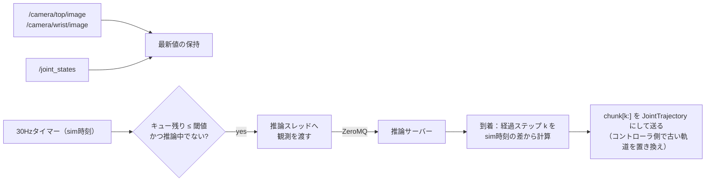

# track2/37. ROS 2ポリシーノードとZeroMQ IPC

> **穴埋め版**（進め方は [03_fill_in_guide](../03_fill_in_guide.md)）
> - 埋めるファイル（穴の数）：`src/evla/ipc/protocol.py`（6）、`src/evla/ipc/client.py`（4）、`src/evla/ipc/server.py`（4）、`scripts/serve_policy.py`（1）、`ros2_ws/src/evla_nodes/evla_nodes/action_mapping.py`（3）、`ros2_ws/src/evla_nodes/evla_nodes/policy_node.py`（3）
> - テスト：`pytest tests/ipc`
> - 「5. 実装手順」は、ゼロから書く場合の手順です。穴埋め版では、手順の中の**確認作業**（動作確認・測定・完了条件）を行い、コードは穴を埋めるだけで足ります。

## 1. 目的と計画書の対応

- ROS（システムPython）と推論（`.venv-bench`）を**別プロセス**に分け、ZeroMQでつなぐ。
- カメラトピック → 推論サーバー → アクションチャンク → JointTrajectoryController、の経路を作る。
- 同期 / 非同期、ロックステップ / 実時間の両方で動かせるようにする。
- 計画書の対応箇所：「プロセス分離」「ポリシー実行の構成」、日程D6「ROS 2ポリシーノード実装」、D7「Gazebo閉ループの疎通確認」、成果物「ROS 2ポリシーノード」

## 2. 前提知識・事前に読む資料

- ZeroMQガイド：<https://zguide.zeromq.org/>（1章：REQ/REP、2章：マルチパート、ゼロコピー、4章：Lazy Pirate）
- pyzmqのゼロコピー送信：<https://pyzmq.readthedocs.io/en/latest/howto/serialization.html>
- msgpack：<https://github.com/msgpack/msgpack-python>
- JointTrajectoryControllerの軌道の置き換え：<https://control.ros.org/jazzy/doc/ros2_controllers/joint_trajectory_controller/doc/trajectory.html>
- 27章のexecutor（同期 / 非同期、古い行動の破棄）

## 3. 成果物

| パス | 役割 |
| --- | --- |
| `src/evla/ipc/protocol.py` | メッセージの定義とエンコード（**NumPy 1.26でも2でも動く**こと） |
| `src/evla/ipc/client.py` | `InferenceClient`（タイムアウトと再接続つき） |
| `src/evla/ipc/server.py` | `InferenceServer`：22章の `Policy` を包む（`.venv-bench` で動かす） |
| `scripts/serve_policy.py` | サーバーの起動CLI（`--config configs/policy/so101_ov_cpu.yaml`） |
| `evla_nodes/policy_node.py` | 実時間モードのポリシーノード |
| `evla_nodes/eval_runner.py` | 評価のエピソード管理。ロックステップのときは時計の所有者として推論ループも回す（38章） |
| `evla_nodes/action_mapping.py` | 方策の出力（度、LeRobotの順序）→ コントローラの指令（rad、URDFの関節名） |
| `tests/ipc/test_protocol.py`、`test_roundtrip.py` | エンコードの往復、サーバーとクライアントの往復 |

## 4. インタフェース仕様

### 4.1 プロトコル

**【判断】** REQ/REP＋マルチパートにする。1フレーム目はmsgpackのヘッダ、2フレーム目以降は配列の生のバイト列。

| フレーム | 内容 |
| --- | --- |
| 0 | msgpack：`{"v": 1, "type": "predict", "id": 123, "task": "...", "arrays": [{"name": "top", "dtype": "uint8", "shape": [480, 640, 3]}, ...], "noise_seed": null, "t_obs_sim": 12.3, "t_send_wall_ns": ...}` |
| 1..N | `arrays` の順に、各配列の `tobytes()`（C連続） |

応答：フレーム0に `{"v": 1, "type": "result", "id": 123, "arrays": [{"name": "actions", ...}], "latency_ms": ..., "breakdown_ms": {...}, "error": null}`、フレーム1に行動チャンク（float32 (50, 6)）。

その他の `type`：`ping`（死活確認）、`describe`（サーバー側の `Policy.describe()`）、`warmup`。

```python
# src/evla/ipc/protocol.py
PROTOCOL_VERSION = 1

def encode(header: dict[str, Any], arrays: Mapping[str, np.ndarray]) -> list[bytes | memoryview]:
    """ヘッダに配列のメタ情報を足して msgpack 化し、[header, buf1, buf2, ...] を返す。
    配列は C 連続にしてから memoryview で渡す（コピーを避ける）。"""

def decode(frames: Sequence[bytes | zmq.Frame]) -> tuple[dict[str, Any], dict[str, np.ndarray]]:
    """np.frombuffer(...).reshape(shape)。v が違えば ValueError。"""
```

```python
# src/evla/ipc/client.py
class InferenceClient:
    def __init__(self, addr: str, timeout_ms: int = 10_000, retries: int = 1) -> None: ...
    def predict(self, images: Mapping[str, np.ndarray], state: np.ndarray, task: str,
                t_obs_sim: float, noise_seed: int | None = None) -> "PredictReply":
        """タイムアウトしたらソケットを作り直し（Lazy Pirate）、retries 回まで再送する。それでも駄目なら TimeoutError。"""
    def ping(self) -> bool: ...
    def close(self) -> None: ...

@dataclass(frozen=True)
class PredictReply:
    actions: np.ndarray            # (chunk, 6)、LeRobotの順序、度
    server_latency_ms: float
    breakdown_ms: Mapping[str, float]
    rtt_ms: float                  # クライアントで測った往復
```

```python
# src/evla/ipc/server.py
class InferenceServer:
    def __init__(self, policy: Policy, bind: str = "tcp://127.0.0.1:5600",
                 image_key_map: Mapping[str, str] = {"top": "image", "wrist": "image2"}) -> None:
        """image_key_map：ROS側のカメラ名 → Policy が期待する Observation.images のキー。
        SO-101のモデルなら {"top": "top", "wrist": "wrist"}、LIBEROのモデルで疎通確認するなら上の既定値。"""
    def serve_forever(self) -> None: ...
```

### 4.2 ポリシーノード（実時間モード）



| パラメータ | 既定 | 意味 |
| --- | --- | --- |
| `server_addr` | `tcp://127.0.0.1:5600` | |
| `mode` | `async` | `sync`（推論中は保持）/ `async` |
| `n_exec` | 25 | 1チャンクから実行する行動数 |
| `async_threshold` | 10 | 非同期で次の推論を始めるキューの残り |
| `control_hz` | 30.0 | |
| `task` | `"Pick up the cube and put it in the box."` | 学習時と**完全に同じ文**にする |
| `joint_map_file` | `evla_sim/config/joint_map.yaml` | 名前・符号・単位の対応（34章の `conventions.py` と同じ内容） |

**【判断】** 行動は1ステップずつ送らず、**チャンク（の残り）を1本の JointTrajectory として送る**。

- コントローラが30Hzの点の間を補間するので、タイマーの揺らぎに強い。
- `header.stamp = 0` の新しい軌道を送ると、コントローラは受信時点から新しい軌道に置き換える。これが、27章の「到着時に古い k 個を捨てて置き換える」にそのまま対応する。
- ただし、置き換えの瞬間に指令が不連続になりうる。滑らかさは記録して評価する（27章の発展課題）。

### 4.3 記録する指標（`/policy/metrics` と CSV）

| 指標 | 計算 |
| --- | --- |
| 推論のRTT、サーバー側の時間 | `PredictReply` |
| 観測から指令までの遅延（sim時刻） | 軌道を送ったsim時刻 − 観測のstamp |
| 実効制御周期 | 新しい軌道を送った間隔の逆数 [Hz]（計画書の「実効制御周期」） |
| キュー枯渇の回数・時間 | 非同期で行動がなくなった時間 |
| 破棄した行動数 | k の合計 |

## 5. 実装手順

1. **プロトコル（1.5時間）**：`encode` / `decode` と往復テスト。uint8画像とfloat32配列、空の配列、非連続配列（転置したもの）を試す。
2. **サーバーとクライアント（2時間）**：`.venv-bench` でサーバーを、別のシェル（システムPython）でクライアントを動かし、固定観測で往復させる。サーバーを途中で殺して、クライアントがタイムアウト→再接続できることを確かめる。
3. **関節の対応（1時間）**：`action_mapping.py`。度→rad、LeRobotの順序→URDFの名前、符号。34章の `conventions.py` と同じ対応表を使い、**変換を往復させて恒等になる**ことをテストする。
4. **ポリシーノード（3時間）**：4.2の図のとおり。推論はスレッドで行い、ROSのコールバックをブロックしない。軌道の時刻は `time_from_start = (i + 1) / control_hz`。
5. **疎通確認（D7、1〜2時間）**：計画書のとおり、まず**LIBEROのモデル**で動かす。行動の次元（7）とロボット（6）が合わないので、先頭6次元を使うなどの仮の対応で、ループが回ることだけを確かめる（成功率は問わない）。推論の遅延、実効制御周期、キュー枯渇が記録されることを確認する。
6. **SO-101のモデルで動かす（D8）**：36章の変換結果を、トラック1の最適設定で動かす。

## 6. ベストプラクティス

- **ROSのコールバックで待たない**：推論は数百ms〜数秒かかる。タイマーのコールバックで推論を待つと、ノード全体が止まる。推論は専用スレッドで行い、結果はキューで受け渡す。
- **sim時刻で計算する**：経過ステップ k は、観測のstampと到着時のsim時刻の差から計算する。壁時計を使うと、RTFが1でないときに破綻する。
- **プロトコルにバージョンを入れる**：ROS側とvenv側でコードの版がずれたとき、黙って誤動作せずにエラーになる。
- **画像は生のバイトで送る**：JPEGに圧縮すると、エンコードとデコードの時間がかかり、画質も変わる（学習データはPNGからの動画）。ローカルの通信なので、帯域は問題にならない。
- **最初のリクエストはウォームアップ**：評価の前に `warmup` を送り、初回のコンパイルを済ませる。

## 7. 落とし穴

| 症状 | 原因 | 対処 |
| --- | --- | --- |
| 推論サーバーを再起動すると、ノードが二度と応答を受け取らない | REQソケットが「受信待ち」の状態で固まった | Lazy Pirate（ソケットを作り直す） |
| 腕がガクガクする | 1点ずつ送っていて、タイマーの揺らぎで補間が乱れる。または `time_from_start` が小さすぎる | チャンクを1本の軌道として送る |
| 腕が逆方向に動く | 符号や関節の対応の間違い | 対応表の往復テスト。1関節ずつ動かして確認する（env/11 Step 5） |
| `np.frombuffer` の配列に書き込めない | 読み取り専用のバッファ | 必要なら `.copy()` する |
| 学習時と挙動が違う | タスク文が1文字でも違う（末尾のピリオド、大文字小文字） | 学習データのタスク文を、メタデータから読み込んで使う |
| 実効制御周期が理論値より低い | 推論がチャンクの消費より遅い（キュー枯渇） | 仕様どおりの結果として記録する。n_exec、閾値を調整する |

## 8. ヒント

<details><summary>L1：ROSのノードの中で、推論の待ちとタイマーをどう両立するか</summary>

推論用のスレッドを1本作り、メインのタイマーとはスレッド安全なキュー（または「最新の結果」を入れる変数＋ロック）でやり取りする。タイマーは「推論中か」「結果が届いたか」を見るだけにする。
</details>

<details><summary>L2：使うAPI</summary>

`sock.send_multipart(frames, copy=False)`、`sock.recv_multipart(copy=False)`、`zmq.Poller().poll(timeout_ms)`、`msgpack.packb(header, use_bin_type=True)`、`np.frombuffer(buf, dtype).reshape(shape)`、`threading.Thread`、`queue.Queue(maxsize=1)`、`trajectory_msgs.msg.JointTrajectory`、`builtin_interfaces.msg.Duration(sec=..., nanosec=...)`、`cv_bridge` を使わずに `np.frombuffer(msg.data, np.uint8).reshape(msg.height, msg.width, 3)`（エンコーディングが `rgb8` であることを確認する）
</details>

<details><summary>L3：ポリシーノードのタイマーの疑似コード</summary>

```
on_timer():                                       # 30Hz（sim時刻）
    now = self.get_clock().now()
    if self.reply_q has item:
        reply, t_obs = self.reply_q.get()
        k = round((now - t_obs).nanoseconds / 1e9 * control_hz)
        rest = reply.actions[k : k + n_exec]
        if len(rest) > 0: publish_trajectory(map_to_urdf(rest)); self.queue_len = len(rest); log(...)
        self.inflight = False
    else:
        self.queue_len = max(0, self.queue_len - 1)
    if not self.inflight and (self.queue_len <= thr or mode == "sync" and self.queue_len == 0):
        obs = snapshot_latest()                   # 画像2枚＋関節、そのstamp
        self.request_q.put(obs); self.inflight = True
```

（syncモードでは、推論中に保持の軌道を送るかどうかを決めておく）
</details>

## 9. 完了条件（DoD）

- [ ] `pytest tests/ipc` が通る（往復、非連続配列、バージョン不一致でエラー）
- [ ] サーバーを殺して再起動しても、クライアントが回復する
- [ ] LIBEROのモデルで、Gazebo上でループが回り、指標（RTT、実効制御周期、キュー枯渇）が記録される（D7）
- [ ] SO-101のモデルで、少なくとも1エピソード、腕がキューブに向かって動く（D8）
- [ ] `/policy/metrics` のCSVが `results/` に保存される

## 10. 理解度チェック・発展課題

- REQ/REPを、DEALER/ROUTERに変えると何ができるようになるか（複数の推論を同時に投げる、など）。この研究で必要か。
- 経過ステップ k の計算に、観測のstampを使う理由は何か。リクエストを送った時刻ではいけないのか。
- 発展：推論サーバーを外部のマシンに置いた場合（30章の発展課題）、プロトコルのどこを変える必要があるか。画像の圧縮は必要になるか。
