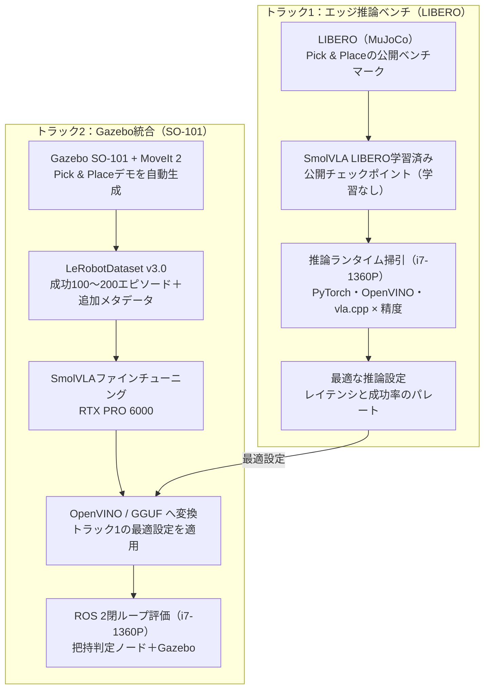

# エッジVLA推論検証 研究計画書

2026-10-12

## 研究の目的と問い

本研究は、CUDAに依存しないエッジ計算資源（x86 CPU＋iGPU）でVLAをオンボード実行したとき、どの条件なら実用的な制御ができるかを2週間で定量化する。

> CUDA非依存のエッジ計算資源で、どのモデル・ランタイム・精度・入力条件が、何Hzの制御で、どの程度のタスク成功率を出せるか。そのパレート境界はどこにあるか。

**背景と動機**

- 現行のVLAはGPUランタイムでの実行が前提で、ロボット内部のボードで動かすことは想定されていない。
- 外部サーバーで推論するとカメラ映像の転送が必要になり、有線化や通信品質への依存が生じて自律性が損なわれる。
- 台数を増やすたびに高性能GPUを割り当てる構成は、スケール時のコストが現実的でない。
- 帯域だけを動機にすると反論に弱い。カメラ2台・640×480・30fpsの生データは約440Mbpsだが、圧縮すれば無線でも送れる。そのため本研究では、遅延・ジッタ・通信断に対する頑健性と、台数スケール時のコストを主な論点とする。

実機ではJetson Orin級のボードを想定する。本検証ではi7-1360P端末をテストケースとし、結果をJetsonへ外挿する。

## 前提条件とスコープ

検証はシミュレーション内で完結させ、手法はVLAに絞る。

| 項目 | 内容 |
| --- | --- |
| 検証端末 | Intel Core i7-1360P（Raptor Lake、NPUなし）、RAM 64GB、Iris Xe（iGPU） |
| OS | Windows 11 + WSL2 |
| 学習環境 | RTX PRO 6000 |
| 期間 | 2週間（10営業日） |
| ロボット | SO-ARM101（5関節＋グリッパの6自由度） |
| タスク | Pick & Place（キューブを箱に入れる） |
| 手法 | VLA（主にSmolVLA） |
| 検証環境 | ROS 2 / Gazebo / LeRobot、およびLIBERO |

**対象外とするもの**

- **RL**：VLAに絞るため扱わない。
- **ピンホール（peg-in-hole）**：公開データのシミュレータやロボットがGazeboと一致しない。またGazeboは、はめあい公差の厳しい接触の物理計算が不安定である。
- **公開実機データのGazebo再生**：カメラの内部・外部パラメータ、関節値の単位、物体位置が記録されておらず、推定コストが大きい（詳細はトラック2の節）。
- **実機展開**：把持をsim上の判定で代替するため、本検証の範囲外とする。

## 推奨構成：2トラック並行

2つのトラックを並行して進める。トラック1で推論設定を確定させ、トラック2はその設定でGazebo上のオンボード閉ループを実証する。



トラック1は学習なしで初日から計測でき、トラック2が遅れても成果が残る。トラック2は自作データでファインチューニングしたモデルを、トラック1で選んだランタイムと精度で動かす。

## 環境構成

WSL2にUbuntu 24.04を追加し、ROS 2 Jazzy＋Gazebo Harmonicで構築する。推論はROSとは別プロセス・別venvに置く。

| 層 | 構成 | 備考 |
| --- | --- | --- |
| OS / ROS | WSL2上のUbuntu 24.04、ROS 2 Jazzy、Gazebo Harmonic | 22.04＋Humbleの標準組み合わせはGazebo Fortress。SO-101のROS 2パッケージ（[lerobot_ws](https://github.com/Ar-Ray-code/lerobot_ws)）はJazzy＋Harmonicで、ros2_controlとMoveIt 2の統合まで揃っている |
| ロボットモデル | SO-101のURDF、ros2_control、MoveIt 2 | TCPフレームを両爪先端の中間に追加する |
| データ形式 | LeRobotDataset v3.0 | 公開SO-101データと同じ関節名・順序 |
| 推論ランタイム | PyTorch CPU、OpenVINO（CPU / GPU）、[vla.cpp](https://github.com/VinRobotics/vla.cpp)（CPU / SYCL） | vla.cppはWSL2とIntel GPUでの動作確認が明記されている |
| iGPUドライバ | WSL2用のIntel GPU compute runtime | OpenVINOはWSL2経由でIris Xeを利用できる |
| ベンチマーク用sim | LIBERO（MuJoCo） | vla.cppの評価スクリプトを流用できる |
| 学習 | RTX PRO 6000、LeRobot | SmolVLAのファインチューニング |

**プロセス分離**：ROS 2とLeRobotはNumPyなどの依存バージョンが衝突しやすい。推論サーバー（vla-serverまたはOpenVINO）を別プロセスに置き、ZeroMQなどのIPCでROS 2ノードとつなぐ。

## トラック1：LIBEROでのエッジ推論ベンチマーク

公開済みのSmolVLA LIBERO学習済みモデルを使い、学習なしで初日から「どの設定ならこの端末で動くか」を確定させる。ここで決めた設定をトラック2に持ち込む。

**対象モデル**

| 位置づけ | モデル | 備考 |
| --- | --- | --- |
| 本命 | [SmolVLA](https://arxiv.org/pdf/2506.01844)（約450M）LIBERO学習済み | [OpenVINO版](https://huggingface.co/modelapi/smolvla-libero-fp16-ov-catalog)とGGUF版が公開済み |
| 上限確認（任意） | π0 / π0.5 / GR00T N1.x（Q4・INT8） | どこで破綻するかを示す。vla.cppにLIBERO用GGUFあり |

参照値として、vla.cppの報告ではRTX 5090でもSmolVLA（2視点・512px）のp50は約50ms、LIBERO-Objectの成功率は90.5%である。CPUではこの数倍〜十数倍のレイテンシを見込む。

**掃引軸**

- ランタイム：PyTorch CPU、OpenVINO CPU、OpenVINO GPU、vla.cpp CPU、vla.cpp SYCL
- 精度：FP32、FP16、INT8、Q8_0、Q4_0
- 入力：解像度、視点数（1・2）
- CPU：スレッド数、Pコア・Eコアの割り当て

**測定モード**

| モード | 内容 | 測るもの |
| --- | --- | --- |
| A：単体ベンチ | 推論のみを実行 | 純粋なレイテンシとスループット |
| B：ロックステップ | 推論中はシミュレーションを停止 | レイテンシと切り離した成功率 |
| C：リアルタイム | シミュレーションを止めずに実行 | 遅延が成功率に与える影響 |

モードCでは推論遅延を人工的に注入し、「許容遅延×アクションチャンク長→成功率」の曲線を描く。あわせて同期推論と非同期推論を比較する。

## トラック2：Gazebo統合とデータセット設計

Gazebo上にSO-101のpick&place環境を自作し、MoveItで生成したデモでSmolVLAをファインチューニングする。そのうえでROS 2経由のオンボード閉ループを実証する。

**公開データを採用しない理由**

公開SO-101データ（例：[merged_all7](https://huggingface.co/datasets/geonmin-kim/merged_all7)、673エピソード）を確認した結果、Gazeboでの再現には次の情報が欠けていた。

- **カメラ**：`meta/info.json` にあるのは解像度・コーデック・fpsだけで、内部・外部パラメータがない。
- **関節値**：単位（±100正規化か度か）がメタデータにない。`stats.json` ではwrist_rollが−168〜−22と±100を超えており、度単位の混在が疑われる。ロボット個体ごとのキャリブレーションも非公開。
- **物体**：キューブや箱の位置が記録されていない。

いずれもロボット自身を目印にした推定は可能だが、2週間では自前で生成するほうが確実である。

**データセット仕様**

| 項目 | 仕様 |
| --- | --- |
| 形式 | LeRobotDataset v3.0 |
| 関節 | 6次元。公開SO-101データと同じ名前・順序（shoulder_pan〜gripper）、度単位で統一 |
| カメラ | top＋wrist、480×640、30fps |
| 規模 | 成功エピソード100〜200 |
| 生成方法 | MoveIt 2によるpick&place。ロックステップで記録 |

形式を公開データに揃えておけば、後で実機データとの共同学習や比較に変換なしでつなげられる。

**追加メタデータ**（`meta/` に別JSONで保存）

- カメラの内部・外部パラメータ
- URDFのバージョン、関節値の単位と符号の規約
- 各エピソードの物体の初期位置と乱数シード
- 成否フラグ、把持時のずれ（軸ごとの距離・角度）、使用した閾値

**データの多様化**

- 配置：キューブの位置・色、箱の位置、アームの初期姿勢
- 軌道：接近高さ、速度、プランナのシード
- 見た目：カメラ位置の微小なずれ、照明、机のテクスチャ
- リカバリー：軌道に小さなノイズを入れ、ずれから立て直す動きを含める

**ポリシー実行の構成**：カメラトピック → 推論プロセス（vla-serverまたはOpenVINO） → アクションチャンク → JointTrajectoryController。

## 把持判定仕様とDetachableJoint実装

キューブ中心とTCPが閾値内で一致し、閉じ指令が出たら、スナップさせずにその時点の相対位置のままキューブを固定する。データ生成とVLA評価で同じ判定を使い、成功率の比較に一貫性を持たせる。

**把持条件**（すべて満たしたら固定）

1. キューブ中心がTCP座標系の許容範囲内にある。球ではなく軸ごとの箱で判定する。
    - 爪の開閉方向：±（開き幅 − キューブ幅）/ 2
    - 上下・前後方向：それぞれ個別に許容値を設定
2. グリッパの閉じ指令が出ている、またはグリッパ角が閾値以下である。
3. キューブのヨー角と爪の開閉軸のずれが±15°以内（立方体なので90°周期で判定）。
4. （任意）TCPの接近方向が鉛直から30°以内。

**解放**：グリッパ角が閾値を超えて開いたら固定を外す。

**タスク成功**：解放後、キューブが箱の内側かつ縁の高さより下にあり、Nフレーム静止している。

**閾値の決め方**：開き幅とキューブ寸法から幾何的に決め、メタデータに記録する。量子化や遅延による精度劣化は成功率に表れるため、閾値は評価指標そのものに影響する。

**DetachableJointによる固定**

GazeboのDetachableJointは、再接続時に子モデルをその時点の位置・姿勢のまま親に固定する（[公式ドキュメント](https://gazebosim.org/api/sim/9/detachablejoints.html)）。何もしなければスナップは起きず、閾値内のずれはそのまま残る。

| 注意点 | 対応 |
| --- | --- |
| 起動時は接続済みの状態から始まる | 各エピソード開始時、アームが動く前にdetachを送る |
| 固定中の爪とキューブの接触でブレや跳ねが出る | collide_bitmaskで爪リンクとキューブの衝突だけを無効にする（机・箱との衝突は残す） |
| 既定の物理エンジンDARTでは、初期接続状態で親子が衝突していないことが必要 | キューブの初期配置を爪から離す |
| エピソードごとにモデルを作り直すと名前管理が煩雑 | キューブは1つにしてset_poseで再配置する |
| 判定から固定までbridge経由の遅延がある | 状態トピックで接続を確認した後の相対姿勢を記録する |

**判定ノードの流れ**

1. TFからTCPの位置、bridge経由でキューブの位置、joint_statesからグリッパ角を取得する。
2. 条件を満たしたら、attachトピックへ `std_msgs/Empty` を送る。
3. グリッパが開いたら、detachトピックへ送る。

```xml
<gazebo>
  <plugin filename="gz-sim-detachable-joint-system"
          name="gz::sim::systems::DetachableJoint">
    <parent_link>gripper_link</parent_link>   <!-- 固定側の爪リンク -->
    <child_model>cube</child_model>
    <child_link>cube_link</child_link>
    <attach_topic>/grasp/attach</attach_topic>
    <detach_topic>/grasp/detach</detach_topic>
  </plugin>
</gazebo>
```

リンク名は使用するSO-101のURDFに合わせる。

**限界**：把持はsim上の判定で代替し、摩擦などは扱わない。指令値の範囲は実機と同じに保ち（閉じ指令をキューブ幅相当で止めるなど）、将来の実機移行に備える。

## 評価指標と測定方法

レイテンシと成功率を軸に、資源消費と把持精度をあわせて記録する。

| 指標 | 定義・単位 | 取得方法 |
| --- | --- | --- |
| 推論レイテンシ | p50 / p99 [ms] | 単体ベンチ、ROSノード内の計測 |
| 実効制御周期 | アクション発行の周期 [Hz] | ポリシーノードのログ |
| タスク成功率 | 成功数 / 試行数 [%] | 把持判定仕様の成功条件 |
| 把持精度 | 把持時のTCP–キューブ間のずれ（軸ごとの距離 [mm]、角度 [°]） | 判定ノードのログ |
| メモリ | ピーク常駐量 [GB] | プロセス監視 |
| 電力 | パッケージ電力 [W] | Windows側の計測ツール |
| シミュレーション速度 | リアルタイム係数（RTF） | Gazeboの統計 |
| 温度・クロック | スロットリングの有無 | Windows側の計測ツール |

**測定条件の統一**

- Windowsの電源プランを「最高パフォーマンス」に固定する。
- P/Eコアを固定し（taskset）、スレッド数を掃引する。
- ウォームアップ後に計測し、長時間実行時は温度とクロックを記録する。

**閾値の感度分析**：把持判定の閾値を複数段階で変えて成功率を算出し、量子化モデルとFP32モデルの差がどの精度帯で開くかを示す。

## 日程と判定ゲート

前半（D1〜D5）で計測基盤とデータを揃え、後半（D6〜D10）で閉ループ評価とまとめを行う。D5の判定ゲートで、トラック2を続けるか縮小するかを決める。

| 日 | トラック1：LIBEROベンチ | トラック2：Gazebo統合 |
| --- | --- | --- |
| D1 | iGPU認識の確認（WSL2）：clinfo・OpenVINOデバイス一覧 | Ubuntu 24.04＋Jazzy＋Harmonic、SO-101をGazeboで起動 |
| D2 | LIBERO起動（MuJoCo描画確認）、SmolVLA PyTorch CPUベースライン | Gazeboシーン構築：机・キューブ・箱・2カメラ・TCP |
| D3 | OpenVINO（CPU / GPU）、vla.cpp（CPU / SYCL）で実行 | MoveIt Pick & Placeスクリプト、把持判定ノード・記録ノード |
| D4 | 掃引：精度×スレッド数×解像度・視点数 | デモ生成（一晩）：成功エピソード100〜200 |
| D5 | LIBERO閉ループ（ロックステップ）：上位3設定の成功率 | データ品質確認、RTX PRO 6000で学習開始 |
| **D5 判定ゲート** | **デモ生成が安定 → ファインチューニングへ ／ 不安定 → トラック2はROS 2経由のレイテンシ測定のみに縮小** | |
| D6 | 遅延注入（リアルタイム）：許容遅延×チャンク長→成功率 | ROS 2ポリシーノード実装：推論は別プロセス（ZeroMQ） |
| D7 | 同期 vs 非同期推論の比較、パレート図の作成 | Gazebo閉ループの疎通確認：LIBEROモデルでパイプライン検証 |
| D8 | （任意）上限確認：π0・GR00T（Q4 / INT8） | 学習済みモデルをOV / GGUFへ変換、Gazebo閉ループ評価・閾値感度分析 |
| D9 | （任意）外部推論との比較：tc netemで遅延・ジッタを注入、Jetson Orinの公開値と照合 | （両トラック共通） |
| D10 | 結果のまとめ：ベンチマーク表・パレート図・遅延許容曲線・報告書 | （両トラック共通） |

判定ゲートでデモ生成が不安定なら、トラック2はROS 2経由のレイテンシ測定に切り替え、トラック1の成果を確実に残す。（任意）の作業は、時間が足りなければ省く。

## リスクと対策

最大のリスクは、シミュレーションと推論が同じCPU/iGPUを取り合って測定値が汚れることである。

| リスク | 影響 | 対策 |
| --- | --- | --- |
| シミュレーションと推論のiGPU競合 | 測定値が汚れる | 測定モードA/B/Cを分ける。iGPU推論の評価はロックステップを基本にする |
| WSL2でのMuJoCo・Gazeboの描画 | LIBEROやカメラが動かない、または遅い | D1〜D2で確認する。カメラ付きでRTF 0.5未満ならロックステップを主軸にする |
| ROS 2とLeRobotの依存関係の衝突 | 環境構築が遅れる | 推論を別プロセス・別venvに置き、ZeroMQでつなぐ |
| MoveIt生成デモの単調さ | ずれから立て直せないポリシーになる | 配置・軌道・見た目のランダム化とノイズ注入を最初から入れる |
| DetachableJointの挙動 | キューブの跳ねや誤った固定 | 衝突マスクの設定、エピソード開始時のdetach |
| OpenVINO Physical AIのAPI変更（プレビュー段階） | 変換手順が動かない | vla.cppやoptimum-intelを代替経路にする |
| D5時点でデモ生成が不安定 | トラック2が遅れる | トラック2をROS 2経由のレイテンシ測定のみに縮小する（LIBEROモデルを流用し、成功率は問わない） |
| サーマルスロットリング | 長時間測定がばらつく | 温度とクロックを記録し、測定間に冷却時間を置く |

## 成果物

2週間の終わりに、次の7点を揃える。

- ベンチマーク表：モデル×ランタイム×精度×入力条件ごとのレイテンシ、メモリ、電力
- パレート図：レイテンシと成功率の関係
- 遅延許容曲線：許容遅延×アクションチャンク長→成功率
- 把持閾値の感度分析
- Gazebo SO-101 pick&placeデータセット（LeRobotDataset v3.0、追加メタデータ付き）と、ファインチューニング済みSmolVLA
- ROS 2ポリシーノードと把持判定ノード
- 報告書：Jetson Orinへの外挿と、外部推論との比較（実施した場合）を含む

## 参考資料

- [SmolVLA: A Vision-Language-Action Model for Affordable and Efficient Robotics（arXiv 2506.01844）](https://arxiv.org/pdf/2506.01844)
- [VinRobotics/vla.cpp](https://github.com/VinRobotics/vla.cpp)（[リリースノート](https://github.com/VinRobotics/vla.cpp/releases)）
- [modelapi/smolvla-libero-fp16-ov-catalog](https://huggingface.co/modelapi/smolvla-libero-fp16-ov-catalog)
- [Physical AI Studio](https://github.com/open-edge-platform/physical-ai-studio/wiki)
- [Intel：OpenVINO Physical AIの発表](https://www.intel.com/content/www/us/en/newsroom/news/client-computing/customers-choose-intel-for-edge-devices.html)
- [Immich：ML hardware acceleration（WSL2でのOpenVINO）](https://docs.immich.app/features/ml-hardware-acceleration)
- [Ar-Ray-code/lerobot_ws（SO-101のROS 2 Jazzy / Gazebo Harmonic）](https://github.com/Ar-Ray-code/lerobot_ws)
- [geonmin-kim/merged_all7](https://huggingface.co/datasets/geonmin-kim/merged_all7)（[info.json](https://huggingface.co/datasets/geonmin-kim/merged_all7/raw/main/meta/info.json)、[stats.json](https://huggingface.co/datasets/geonmin-kim/merged_all7/raw/main/meta/stats.json)）
- [Community Dataset v3：関節値の単位混在に関する議論](https://huggingface.co/datasets/lerobot/community_dataset_v3/discussions/3)
- [LeRobot docs：Backward compatibility](https://huggingface.co/docs/lerobot/en/backwardcomp)
- [Gazebo Sim API：Detachable Joints](https://gazebosim.org/api/sim/9/detachablejoints.html)
