# エッジVLA推論検証 報告書

2026-10-30

## 1. 要旨

**問い**
CUDA を使わないエッジの計算資源（x86 CPU と iGPU）で VLA をオンボードで動かしたとき、どのランタイム・精度なら、どの程度の速さと成功率で制御できるか。

**方法**
- 端末：i7-1360P（Iris Xe）。
- モデル：公開されている SmolVLA の LIBERO 学習済みモデル。
- 比べたもの：
  - 3つのランタイム（PyTorch、OpenVINO、vla.cpp）と、それぞれの精度・デバイス
  - OpenVINO の重みの 8bit・4bit 量子化
  - 同期実行と非同期実行
- 測ったこと：
  - 推論だけのレイテンシ（モードA）
  - LIBERO-Object の閉ループでの成功率（モードB：同期、モードC：非同期）

**主な数値**
1. **OpenVINO の GPU 版で、重みを 8bit にするのが一番よかった**。
   - 推論の中央値は、NNCF の int8 で 782 ms、公開の w8a16 で 876 ms。PyTorch の CPU 版（fp32、4093 ms）より 4.7〜5.2 倍速い。
   - 成功率は、w8a16 で 0.96（48/50）。量子化しない fp16（0.94）から下がらなかった。
   - 4bit（int4）では、速さはほぼ同じ（803 ms）で、成功率が 0.70 に下がった。
2. **同期実行では、どの設定も実時間（20 Hz）に届かなかった**。
   - 最も速い設定でも、推論の待ちを含めた実効の制御周期は 6.2 Hz だった。
   - 成功したエピソードは、約 7.4 秒の動作に、実時間で約 23 秒かかった。
3. **推論の時間をそのまま遅延として返す非同期実行では、成功率が下がった**。
   - 次の推論を早めに始める設定（threshold 20）にして、ロボットが止まらずに済んでも、0.66 だった。
   - 仮想の遅延を変えて測ると、0 ms で 0.96、500 ms で 0.66、1000 ms 以上で 0 だった。

## 2. 背景と動機

- 今の VLA は GPU での実行を前提にしていて、ロボットの中のボードで動かすことは想定されていない。
- 外部のサーバーで推論すると、次の問題が出る。
  - 遅延・ジッタ・通信断に弱くなる。
  - 台数を増やすたびに GPU を割り当てる必要があり、コストが現実的でなくなる。
- 本研究の狙いは、CUDA を使わない x86 CPU と iGPU の端末で、オンボードの推論がどこまで実用になるかを数値で示すことである。実機では Jetson Orin 級のボードを想定する。i7-1360P の結果は、公開されているベンチの値を使って Jetson と比べる（6.3節）。
- 当初の計画では、2つのトラックを並行して進めるつもりだった。
  - トラック1：LIBERO でランタイムを比べる。
  - トラック2：Gazebo の SO-101 で自作データを作り、ファインチューニングして閉ループで評価する。
- 締め切りに合わせて、**提出はトラック1に絞り**、トラック2は環境構築までの記録にした（`docs/decisions.md`、2026-10-28）。

## 3. 実験環境

| 項目 | 内容 |
| --- | --- |
| CPU | Intel Core i7-1360P（Raptor Lake、P コア 4＋E コア 8、16 スレッド。NPU なし、AMX・AVX512-BF16 なし） |
| GPU | Iris Xe（96 EU、`Intel(R) Graphics [0xa7a0]`。専用の VRAM はなく、メインメモリを共有する） |
| メモリ | 32GB。WSL2 には 16GB を割り当てた（`.wslconfig`。10/27〜28 のモードBの OV の2本は 24GB のとき）。Windows のページファイルは 100GB |
| OS | Windows 11＋WSL2、Ubuntu 22.04（glibc 2.35） |
| GPU のランタイム | Intel compute runtime 25.13.33276.16（IGC 2.10.8）、Level Zero loader 1.17 |
| Python の環境 | Python 3.12.15、torch 2.11.0+cpu、openvino 2026.4.1、physicalai 0.3.0、lerobot 0.6.1、transformers 5.15.1、numpy 2.2.6 |
| vla.cpp | 06ffae9（2026-10-26）。CPU 版、SYCL 版（oneAPI 2025.3、`GGML_SYCL_SUPPORT_LEVEL_ZERO_API=OFF`）、OpenVINO 版（OpenVINO 2026.4.1、`GGML_OPENVINO_DEVICE=GPU`）の3つをビルドした |
| シミュレータ | LIBERO（MuJoCo）。描画は `MUJOCO_GL=glfw`（WSLg） |
| コード | このリポジトリの master（16de831） |

**WSL2 での制約**
- WSL2 の上でこの端末を動かすには、いくつか回避策が要った（`docs/env/`、`docs/decisions.md`）。
  - ggml-sycl は、Level Zero の Sysman（`zesInit`）を呼ぶと segfault した。Level Zero API を使わない設定でビルドした。
  - jammy で動く compute runtime は 25.13 が最新だった（latest の 26.x は glibc 2.38 を要求する）。
  - MuJoCo の描画は glfw だけが動いた（EGL と OSMesa は失敗した）。
- 夜間の実行の途中で、WSL ごと止まったことが一度ある。OpenVINO GPU を1時間以上回した直後に、vla.cpp の SYCL 版が GPU のメモリを確保しようとして失敗した（`dxgkio_reserve_gpu_va: Ioctl failed: -75`）。Windows のコミット済みメモリが足りなくなったと見ている。ページファイルを増やし、WSL のメモリの上限を下げて、SYCL 版を単独で回すようにしたら再発しなかった（`docs/decisions.md`、2026-10-29）。

## 4. 方法

### 4.1 モデルとランタイム

学習はしていない。公開されている同じ SmolVLA の LIBERO 学習済みモデルを、3つの形式で使った。

| ランタイム | モデル | デバイスと精度 |
| --- | --- | --- |
| PyTorch | `HuggingFaceVLA/smolvla_libero` | CPU、fp32 / bf16（bf16 は保存されたままの混合精度：VLM は bf16、射影の層は fp32） |
| OpenVINO（physicalai） | `OpenVINO/smolvla-libero-{fp16,w8a16}-ov`、NNCF で量子化した int8・int4（下記） | CPU / GPU、実行精度のヒント（`INFERENCE_PRECISION_HINT`）は f32 / f16 |
| vla.cpp（vla-server） | `vrfai/smolvla-libero-gguf` | CPU、SYCL（GPU）、OpenVINO（GPU） |

共通の条件は次のとおり。
- 入力は2視点（`image`、`image2`）で、512px。
- flow matching のステップ数は 10。
- 行動のチャンクは 50 ステップ × 7 次元。
- CPU のスレッド数は 8。

vla.cpp は別プロセスの vla-server として起動し、ZeroMQ で呼んだ。

**重みの量子化**（`scripts/quantize_ov.py`）
- 方式：fp16 の IR から、NNCF 3.4.0 でデータを使わずに重みだけを量子化した。活性は f16/f32 のままである。
- 作った IR：

| IR | 方式 | 大きさ |
| --- | --- | ---: |
| int8 | INT8_ASYM（出力チャネルごと） | 525 MB |
| int4 | INT4_ASYM（group size 32、全層。NNCF の既定どおり、3 層は INT8 で残る） | 322 MB |
| （参考）fp16 | 量子化なし | 1046 MB |

- group size を 32 にした理由：既定の 128 は、SmolVLA の線形層のチャネル数（960・480・320）を割り切れず、量子化に失敗したため。
- 公開されている w8a16（INT8 の重み）は、Intel が作ったもので、比べるためにそのまま使った。

### 4.2 測定のモード

| モード | 内容 | 条件 |
| --- | --- | --- |
| A：推論だけ | 固定した観測（`data/fixed_obs/libero_object_t0.npz`）で、推論1回の時間を測る | ウォームアップ 3 回＋計測 50 回を1実行とする。各設定を3周回し、周ごとに順番を入れ替え、実行の間に 60 秒あける。報告するのは、3周の p50 の中央値と、全計測の最小値 |
| B：ロックステップ | 推論の間はシミュレーションを止める同期実行。チャンクのうち先頭の `n_exec=10` ステップを実行してから、次の推論をする | LIBERO-Object、10 タスク × 初期状態 5 通り = 50 エピソード。制御は 20 Hz、1エピソードは最大 280 ステップ |
| C：非同期 | 推論をしている間も、前のチャンクを実行し続ける。キューの残りが `async_threshold` 以下になったら次の推論を始め、届いたチャンクのうち推論中に過ぎた分（遅延のステップ数）は捨てる。行動が尽きたら、腕を止め、グリッパはそのままにして待つ（hold） | OV GPU fp16、`n_exec=25`。遅延は2通りで与えた。① 実測の推論時間そのまま（`latency.type=measured`、threshold 10・20）② 仮想の一定の遅延 0〜2000 ms（`constant`、threshold 10。遅延許容曲線）。各 50 エピソード |

**時間制限の数え方**（同期と非同期で違う）
- LIBERO-Object では、1エピソードは最大 280 ステップ（20 Hz で 14 秒）である。
- モードB（ロックステップ）では、推論の間はシミュレーションが止まるので、推論の時間は 280 ステップに数えない。
- モードCでは、遅延の間もシミュレーションの時間が進む。待っている間（hold）も 280 ステップに数える。つまりモードCは、「実時間の 14 秒の中でタスクを終えられるか」を測っている。

**乱数の扱い**
- エピソードの乱数シードは、（seed、タスク、初期状態）から決まる値にした。どの設定でも同じ初期状態の集合を使う。
- PyTorch と vla.cpp には、固定したノイズを与えた。
- OpenVINO の IR はノイズを入力に取らないので、中で生成したノイズを使う。

### 4.3 タスク（LIBERO-Object）

LIBERO-Object の 10 タスクは、どれも「指定された物体をつかみ、左のかごに入れる」タスクである。
- 床には、対象のほかにも似た形の食品（缶、瓶、箱）がいくつも置かれている。
- 指示文で対象を区別する必要があり、言語の理解と物体の見分けが問われる。
- 初期状態（物体の配置）は、各タスクで固定された 50 通りのうち、0〜4 番を使った。

下の図は、各タスクの初期状態 0 である（`scripts/render_task_images.py` で作成）。指示文は 5.2節の表にある。

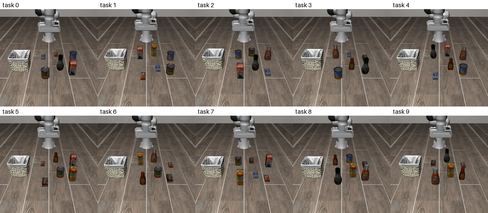

### 4.4 掃引

モードAで、次の組み合わせを3周ずつ回した（`configs/sweep/stage1.yaml`、`configs/sweep/stage1_sycl.yaml`）。

| ランタイム | 組み合わせ |
| --- | --- |
| PyTorch | fp32、bf16 |
| OpenVINO GPU | 精度のヒント（f32、f16）× 重み（fp16、w8a16） |
| OpenVINO CPU | f32 × 重み（fp16、w8a16） |
| vla.cpp | CPU、SYCL、OpenVINO（GPU） |
| OpenVINO の量子化（段2、`configs/sweep/stage2_quant.yaml`） | 重み（NNCF の int8、int4）× デバイス（GPU f16、CPU f32） |

閉ループの評価（モードB）は、次の5つで行った。
- OpenVINO GPU fp16：モードAで最も速かった精度
- OpenVINO GPU fp16、公開の w8a16（8bit）
- OpenVINO GPU fp16、NNCF の int4（4bit）
- vla.cpp の OpenVINO 版：vla.cpp の中で最も速かった版
- PyTorch CPU fp32：基準

モードC（非同期）は、すべて OpenVINO GPU fp16（量子化なし）で回した。

## 5. 結果

数値は `scripts/make_report_tables.py` が作る表（`reports/benchmark_table.md`、`reports/success_table.md`）から引いている。

### 5.1 推論のレイテンシ（モードA）

| 設定 | p50 [ms] | p90 [ms] | 最小 [ms] | 読み込み [s] | ピークのメモリ [MB] |
| --- | ---: | ---: | ---: | ---: | ---: |
| OV GPU f16、重み int8（NNCF） | **782** | 828 | 756 | 75 | 2058 |
| OV GPU f16、重み int4（NNCF） | 803 | 836 | 760 | 87 | 2337 |
| OV GPU f16、重み w8a16（公開） | 876 | 923 | 826 | 81 | 2009 |
| OV GPU f16、重み fp16 | 922 | 954 | 875 | 80 | 1955 |
| OV GPU f32、重み w8a16 | 1172 | 1219 | 1099 | 75 | 1931 |
| vla.cpp OpenVINO 版（GPU） | 1281 | 1326 | 1193 | 5 | 917（＋サーバー 4291） |
| OV GPU f32、重み fp16 | 1638 | 1694 | 1558 | 75 | 2117 |
| OV CPU f32、重み int8（NNCF） | 1817 | 1868 | 1739 | 15 | 2895 |
| OV CPU f32、重み int4（NNCF） | 1894 | 1932 | 1752 | 18 | 2729 |
| OV CPU f32、重み fp16 | 2934 | 3060 | 2791 | 16 | 4824 |
| PyTorch CPU fp32 | 4093 | 4268 | 3647 | 21 | 3676 |
| vla.cpp CPU 版 | 4851 | 5056 | 4691 | 6 | 921（＋サーバー 1117） |
| vla.cpp SYCL 版（GPU） | 5442 | 8722 | 2965 | 6 | 918（＋サーバー 530） |
| PyTorch CPU bf16 | 16527 | 17650 | 14101 | 22 | 3745 |
| OV CPU、重み w8a16（公開） | — | — | — | — | — |

- OV CPU と公開の w8a16 の組み合わせは、OpenVINO 2026.4.1 の CPU プラグインがモデルをコンパイルする段階で失敗し、3周とも動かなかった（`Check 'm_element_type.is_static()' failed`）。同じ 8bit でも、NNCF で作った int8 は CPU で動いた。
- vla.cpp の行の p50 には、ZeroMQ の往復と前処理が含まれる。
- vla.cpp の行のピークのメモリは、評価プロセスとサーバーのプロセスを分けて書いた。

**読み取れること**
- **GPU では、精度を f16 にするのが一番効く**。f32 から f16 にすると、1.8 倍速くなった（1638 → 922 ms）。
- **重みの量子化も効く**。
  - GPU では、int8 で 15%、int4 で 13% 速くなった（922 → 782・803 ms）。
  - CPU では、効き目がもっと大きかった。int8 で fp16 の IR の 1.6 倍速くなった（2934 → 1817 ms）。
  - 4bit は 8bit より速くならなかった。重みを読む量は減るが、group size 32 で元に戻す処理が増えるためと考えられる（確かめてはいない）。
- **CPU では、OpenVINO が PyTorch より速かった**。fp16 の IR で 1.4 倍、int8 で 2.3 倍（4093 → 1817 ms）。vla.cpp の CPU 版は PyTorch より遅かった。
- **PyTorch の bf16 は fp32 の 4 倍遅かった**。i7-1360P には bf16 の演算器（AMX、AVX512-BF16）がないため。
- **vla.cpp の SYCL 版は、ばらつきが大きかった**。p90 が p50 の 1.6 倍あり、最小値（2965 ms）と中央値（5442 ms）も大きく離れていた。同じ GPU でも、vla.cpp の OpenVINO 版は安定していた（p90/p50 = 1.04）。
- **読み込みの時間には、トレードオフがあった**。
  - physicalai の OV GPU は、読み込みのときに GPU 向けのコンパイルをするので、約 80 秒かかる。
  - vla.cpp の OpenVINO 版は、読み込みは 5 秒だが、最初の推論のときにコンパイルするので、1回目だけ約 93 秒かかった（動画の記録で確認）。

### 5.2 閉ループでの成功率（モードB）

| 設定 | 成功 | 成功率（95% CI、Wilson） | 推論 p50 [ms] | 実効の制御周期 [Hz] | 成功したエピソードの実時間（中央値） | 全体 [分] |
| --- | ---: | --- | ---: | ---: | ---: | ---: |
| OV GPU f16、重み w8a16（8bit） | 48/50 | **0.96**（0.87–0.99） | 783 | 6.2 | 23.3 s | 21 |
| OV GPU f16、重み fp16 | 47/50 | 0.94（0.84–0.98） | 884 | 5.0 | 28.8 s | 26 |
| PyTorch CPU fp32 | 41/50 | 0.82（0.69–0.90） | 3758 | 2.1 | 66.2 s | 65 |
| vla.cpp OpenVINO 版 | 39/50 | 0.78（0.65–0.87） | 1395 | 3.5 | 37.8 s | 41 |
| OV GPU f16、重み int4（4bit） | 35/50 | 0.70（0.56–0.81） | 786 | 6.3 | 23.7 s | 25 |

- 実効の制御周期は、全エピソードのステップ数の合計を、実時間の合計で割った値。推論の待ちと、シミュレーション・描画の時間を含む。
- 成功したエピソードのステップ数の中央値は、140〜148 ステップだった。20 Hz の制御では、約 7 秒の動作に当たる。
- 閉ループ中の推論 p50 は、モードAより少し短い。観測が毎回変わることや、計測した時期の違いによると考えられる。
- 8bit（w8a16）は、fp16 と成功率がほぼ同じで、推論は 11% 速かった。
- 4bit（int4）は、成功率が 0.70 に下がった。95% CI（0.56–0.81）は、fp16・8bit の CI と重ならない。

**タスクごとの成功数**（各設定 5 エピソード中。画像は初期状態 0）

| タスク | 初期状態 | 指示文 | OV fp16 | OV 8bit | OV 4bit | PyTorch | vla.cpp OV | 計（/25） |
| ---: | --- | --- | ---: | ---: | ---: | ---: | ---: | ---: |
| 0 | 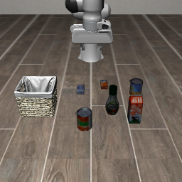 | pick up the alphabet soup and place it in the basket | 4 | 5 | 3 | 5 | 5 | 22 |
| 1 | 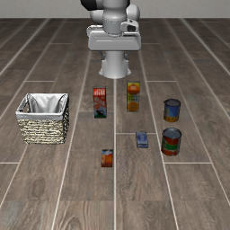 | pick up the cream cheese and place it in the basket | 5 | 5 | 5 | 5 | 4 | 24 |
| 2 | 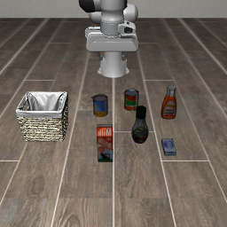 | pick up the salad dressing and place it in the basket | 5 | 5 | 5 | 4 | 4 | 23 |
| 3 | 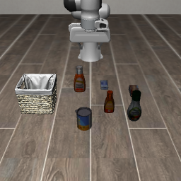 | pick up the bbq sauce and place it in the basket | 5 | 5 | 3 | 5 | 3 | 21 |
| 4 | 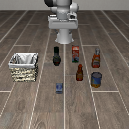 | pick up the ketchup and place it in the basket | 3 | 3 | **0** | 2 | 2 | **10** |
| 5 | 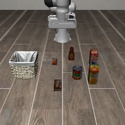 | pick up the tomato sauce and place it in the basket | 5 | 5 | 3 | **1** | 3 | 17 |
| 6 | 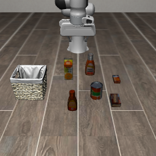 | pick up the butter and place it in the basket | 5 | 5 | 5 | 5 | 5 | 25 |
| 7 | 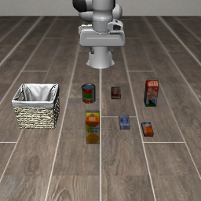 | pick up the milk and place it in the basket | 5 | 5 | 2 | 4 | 4 | 20 |
| 8 | 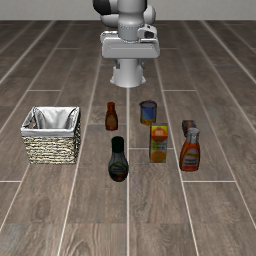 | pick up the chocolate pudding and place it in the basket | 5 | 5 | 5 | 5 | 5 | 25 |
| 9 | 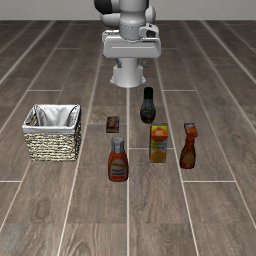 | pick up the orange juice and place it in the basket | 5 | 5 | 4 | 5 | 4 | 23 |

- タスク 4（ケチャップ）は、どの設定でも失敗が多かった（計 10/25）。4bit では 0/5 だった。床には似た形の瓶がいくつも並んでいて、対象を見分けにくいためと考えられる（画像を見ての推測で、確かめてはいない）。
- 4bit の失敗は、タスク 4（0/5）、7（2/5）、0・3・5（3/5）に多かった。量子化の誤差が、物体の見分けに効いている可能性がある。
- タスク 5（トマトソース）は、PyTorch だけが 1/5 と極端に低かった。各セル 5 エピソードなので、偶然の差である可能性も大きい。
- タスク 6（バター）と 8（チョコレートプリン）は、どの設定も 5/5 だった。

### 5.3 パレート図

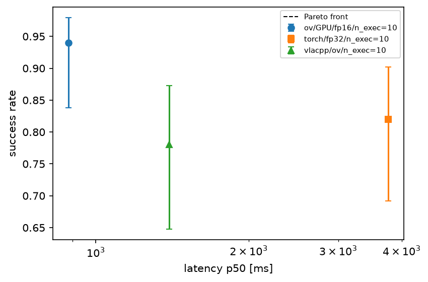

- 横軸は閉ループ中の推論の p50（対数）、縦軸は成功率で、誤差棒は 95% CI。
- モードBの5つの設定と、実測の遅延で動かした非同期（5.4節）の2つを載せた。
- 8bit（w8a16）は、速さでも成功率でも他の設定を上回った。そのため、パレートフロントはこの1点になる。

### 5.4 非同期実行（モードC）

**① 実測の推論時間を遅延にした場合**（この端末で、実時間で止まらずに動かしたときに相当する）

| async_threshold | 成功率（95% CI） | 推論 p50 [ms] | 待ったステップ / エピソード | 捨てた行動 / エピソード | 成功したエピソードの長さ（中央値） |
| ---: | --- | ---: | ---: | ---: | ---: |
| 10 | 0.02（0.00–0.10） | 809 | 72 | 132 | 178 ステップ（8.9 s） |
| 20 | 0.66（0.52–0.78） | 801 | 17 | 132 | 157 ステップ（7.8 s） |

- 推論の約 0.8〜1 秒は、16〜20 ステップに当たる。
- threshold 10 だと、キューの残り 10 ステップ分を使い切ってから、新しいチャンクが届くまで毎回待つ。待つ時間も 14 秒の制限に数えるので、ほとんど時間切れになった。
- threshold 20 では、待ちはほぼ最初の1回だけになった。それでも成功率は 0.66 で、同期（0.94）より下がった。推論中に過ぎた 16〜20 ステップ分、古い観測から作った行動を使うことの影響と考えられる。
- 成功したエピソードは、実時間でも 7.8 秒で終わった。同期実行（8bit で 23.3 秒）のように、推論のたびに止まることはない。

**② 遅延許容曲線**（仮想の一定の遅延、threshold 10）

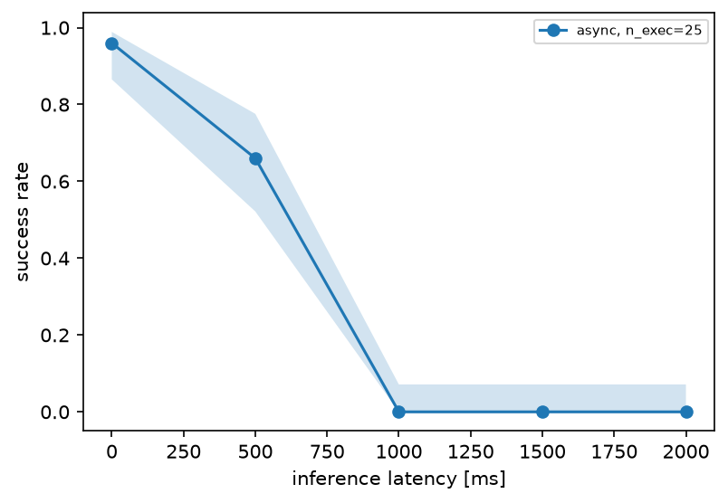

| 遅延 [ms] | 0 | 500 | 1000 | 1500 | 2000 |
| --- | --- | --- | --- | --- | --- |
| 成功率 | 0.96 | 0.66 | 0.00 | 0.00 | 0.00 |
| 95% CI | 0.87–0.99 | 0.52–0.78 | 0.00–0.07 | 0.00–0.07 | 0.00–0.07 |
| 待ったステップ / エピソード | 0 | 10 | 90 | 150 | 205 |

- 遅延 0 ms では、同期（0.94）と同じ程度の 0.96 だった。
- 500 ms で 0.66 に下がり、1000 ms 以上では1本も成功しなかった。
- 1000 ms 以上で失敗したエピソードは、すべて 280 ステップで時間切れだった。待っている時間が長く、成功に必要な約 145 ステップの行動を、14 秒の中で実行しきれない。
- この曲線は threshold 10 で測った。threshold を遅延に合わせて上げれば、待ちは減る（①の threshold 20）。ただし、古い観測から作った行動を使う影響は残る。

### 5.5 一致の確認

固定した観測とノイズで、OpenVINO 版の行動のチャンクを PyTorch と比べた（`reports/equivalence_libero.md`）。

| 比べたもの | cosine の最小 | 最大の絶対誤差 | グリッパの符号の反転 |
| --- | ---: | ---: | ---: |
| OV CPU と PyTorch | 0.72 | 2.01 | 15 |
| OV GPU と PyTorch | 0.72 | 2.01 | 15 |

- OV の CPU 版と GPU 版は、互いにほぼ一致した。
- PyTorch とずれた主な原因は、OV の IR が中でノイズを生成していて、同じノイズを与えられないことだと考えている。flow matching ではノイズが違えば行動も違う。
- それでも、成功率は PyTorch より低くなかった（5.2節）。このずれが性能を落としているとは見ていない。

### 5.6 動画

各モードの動画は `results/videos/` にある（`scripts/record_videos.sh` で作り直せる）。

- `task{0,4}_sim.mp4`：4つの設定を、シミュレーション時間をそろえて並べたもの。
- `task{0,4}_wallclock.mp4`：モードBの3つの設定を、実時間で並べたもの。最初の推論のウォームアップは除いた。
  - 30 秒の時点で、OV GPU は 176 ステップ、vla.cpp OV は 140 ステップ、PyTorch は 60 ステップまで進んでいた。
  - 推論の速さの違いが、ロボットが止まっている時間の違いとして見える。

量子化と非同期の動画は、タスク 4 と 7 の初期状態 1 で撮った（`scripts/record_videos_async_quant.sh`）。この初期状態では、設定ごとに成否が分かれた。
- `quant_task{4,7}.mp4`：同期の fp16、8bit（w8a16）、4bit（int4）を、シミュレーション時間をそろえて並べたもの。
  - どちらのタスクも、fp16 と 8bit は成功し、4bit は失敗した。
  - タスク 7 では、4bit も牛乳パックを持ち上げたが、かごに届く前に落とし、時間切れになった。
- `realtime_task{4,7}.mp4`：同期の 8bit と、実測の遅延での非同期（threshold 10・20）を、実時間に相当する時間で並べたもの。
  - 同期の 8bit は、推論の待ちを含む実時間で並べた。
  - 非同期は、遅延をシミュレーションの中で進めているので、シミュレーション時間がそのまま実時間に当たる。
  - タスク 4 の 10 秒の時点で、同期は 50 ステップまでしか進んでいなかった。非同期の threshold 10 は 200 ステップまで進んでいたが、待ちを繰り返していて、まだつかめていなかった。
  - 非同期の threshold 20 は、8.3 秒で成功していた。

## 6. 考察

### 6.1 計画書の問いへの答え

> CUDA 非依存のエッジ計算資源で、どのモデル・ランタイム・精度・入力条件が、何 Hz の制御で、どの程度のタスク成功率を出せるか。

i7-1360P では、**OpenVINO の GPU 版を f16 で動かし、重みを 8bit にする**のが、速さでも成功率でも最もよかった。推論は約 0.8 秒で、LIBERO-Object での成功率は 0.96 だった。

ただし、これは同期実行（ロックステップ）での値である。
- 実効の制御周期は 6.2 Hz にとどまり、LIBERO の制御周期 20 Hz の3分の1以下だった。チャンクのうち 10 ステップ（0.5 秒分）を実行するたびに、約 0.8 秒止まって推論するためである。
- シミュレーションの中なら、止まっている間に世界は進まず、推論の時間も時間制限に数えないので、成功率は落ちない。
- 実機では、止まっている間にも時間は進む。
- だからこの結果は「同期実行なら、実時間の約 3 倍の時間をかければ動く」という意味で、実時間での実用性を示すものではない。

実時間で止まらずに動かす非同期実行では、同じ推論の速さでも、成功率は 0.66 に下がった（5.4節）。**この端末の推論の速さでは、20 Hz の実時間の制御で、同期と同じ成功率は出せなかった**。

### 6.2 実時間で動かすための条件

20 Hz で止まらずに動かすには、非同期実行（推論中も前のチャンクを実行し続ける）が要る。5.4節の結果から、次の2つの条件が分かった。

1. **次の推論を、遅延より早めに始めること**。
   - キューの残りが遅延のステップ数より少なくなってから推論を始めると、新しいチャンクが届くまでロボットが止まる。
   - 止まった時間は、実時間の制限を食う。実測の遅延で threshold 10 では 0.02、20 では 0.66 だった。
2. **遅延そのものを短くすること**。
   - 止まらずに済んでも、遅延の分だけ古い観測から作った行動を使うので、成功率は下がる。
   - 遅延許容曲線では、0 ms で 0.96、500 ms で 0.66 だった。
   - 同期と同じ程度の成功率を保つには、遅延を 500 ms よりかなり短く（数百 ms 以下に）する必要がありそうである。ただし、0〜500 ms の間は測っていない。

### 6.3 Jetson との比較

vla.cpp の公開されているベンチの値（SmolVLA、2視点・512px、`vla-bench` の最小レイテンシ）と並べた。

| 端末 | ランタイム | 最小 [ms] | 出典 |
| --- | --- | ---: | --- |
| Jetson AGX Orin | vla.cpp CUDA | 218 | 公開値 |
| Jetson Orin NX 16GB | vla.cpp CUDA | 411 | 公開値 |
| Jetson Orin Nano Super | vla.cpp CUDA | 463 | 公開値 |
| Intel Arc B390 iGPU | vla.cpp OpenVINO | 500 | 公開値 |
| Intel Core i7-14700F | vla.cpp CPU | 1689 | 公開値 |
| **i7-1360P、Iris Xe** | OpenVINO（physicalai）f16、int8 | 756 | 本研究（モードA） |
| **i7-1360P、Iris Xe** | vla.cpp OpenVINO | 1193 | 本研究（モードA） |
| **i7-1360P** | vla.cpp CPU | 4691 | 本研究（モードA） |

- 本研究の値はモードAの最小値で、ZeroMQ と前処理を含む。測り方が `vla-bench` と同じではないので、比べられるのはおおよその倍率だけである。
- Jetson Orin NX・Nano Super は、本研究で最も速かった設定の 1.6〜1.8 倍速い。AGX Orin は約 3.5 倍速い。

**遅延許容曲線からの読み取り**（非同期、threshold 10）
- 曲線の 0 ms と 500 ms の間を直線で補間すると、次のように読める。

| 端末 | 遅延 | 成功率の読み |
| --- | ---: | ---: |
| AGX Orin | 218 ms | 約 0.83 |
| Orin NX | 411 ms | 約 0.71 |
| Orin Nano Super | 463 ms | 約 0.68 |
| 本研究の端末（実測の遅延、threshold 20） | 約 800 ms | 0.66（実測） |

- 補間の前提：2点の間の直線補間である。また、Jetson と i7-1360P でモデルの行動が同じとみなしている。
- Jetson の値は、推論の時間だけである。カメラの前処理や通信の時間は含まない。
- 数値の誤差は大きい。それでも、「Orin 級でも、非同期で止まらずに動かすと、同期の成功率（0.94〜0.96）からは下がる」と見込まれる。

### 6.4 ランタイムの選び方

- **Intel の iGPU があるなら**、OpenVINO の GPU 版を f16 で使い、重みは 8bit にする。
  - 公開の w8a16 でも、NNCF で作った int8 でもよい。int8 は CPU でも読める。
  - 読み込みに約 80 秒かかるので、起動時に一度だけ読み込む使い方が前提になる。
- **4bit は使わない**。この端末では 8bit より速くならず、成功率は 0.70 に下がった。
- **vla.cpp は、読み込みが速く（5 秒）、メモリも小さい**。
  - OpenVINO 版の GPU は、OV（physicalai）の fp16 の 1.4 倍の遅さで、成功率も低めだった（CI は重なる）。
  - Jetson とコードをそろえたいなら、vla.cpp は有力な候補になる。
- **vla.cpp の SYCL 版は、この環境では勧めない**。遅く、ばらつきが大きく、WSL2 ごと止まったことがある。
- **CPU だけなら、OpenVINO の int8**（1.8 秒）を使う。PyTorch の bf16 は、bf16 の演算器を持たない CPU では使わない。

## 7. 限界

- **試行数が少ない**。各設定 50 エピソードでは、成功率の CI の幅が ±0.1 前後ある。fp16・8bit・PyTorch・vla.cpp の間の差は、統計的にははっきりしない。
- **一つのタスク群でしか測っていない**。LIBERO-Object だけで、他のスイート（Spatial、Goal、10）は測っていない。
- **非同期の条件が限られる**。
  - 遅延許容曲線は、`n_exec=25`、threshold 10 の1通りだけで、0〜500 ms の間の点もない。
  - Jetson での成功率の読みは、2点の直線補間である。
  - 推論中にロボットを止めて待つ同期実行（`executor.mode=sync`）で、遅延を変えた場合は測っていない。
- **時間制限の影響がある**。非同期では、待っている時間も LIBERO の 14 秒の制限に数える。遅延 1000 ms 以上での 0 は、すべて時間切れである。制限を延ばせば、成功するエピソードもありうる。
- **量子化は、重みだけの1通りずつである**。int4 は group size 32・全層の1通りだけで、ratio（INT8 で残す層の割合）や、データを使う量子化（AWQ など）は試していない。
- **電力を測っていない**。エッジでの比較で重要な、電力あたりの性能は出していない。
- **WSL2 の制約がある**。
  - P コアと E コアへのスレッドの割り当ては、Windows が決めていて、制御できない。
  - モードBの OV fp16 と vla.cpp の2本（24GB）と、その他の実行（16GB）で、WSL のメモリの上限が違う。
  - iGPU はメインメモリを共有するので、ほかの作業の影響を受けうる。
- **シミュレーションでの評価である**。LIBERO と実機では、カメラ・照明・物体・動力学が違う。
- **トラック2はやっていない**。Gazebo の SO-101 での自作データ、ファインチューニング、ROS 2 での閉ループは、環境構築で止めた（8節）。

## 8. 結論と次の一手

**結論**
- i7-1360P のような CUDA を持たないノート PC 級の端末でも、OpenVINO で iGPU を使い、重みを 8bit にすれば、SmolVLA を約 0.8 秒で推論できた。LIBERO-Object では、同期実行で 0.96 の成功率を出せた。
- ただし同期実行の制御の実効は 6 Hz で、実時間の 3 分の 1 以下だった。
- 実時間で止まらずに動かす非同期実行では、成功率は 0.66 に下がった。遅延許容曲線では、遅延 500 ms で 0.66、1000 ms 以上で 0 だった。
- Jetson Orin 級のボードなら、推論は 1.6〜3.5 倍速くなる見込みである。曲線からの読みでは、非同期での成功率は 0.7〜0.8 程度で、同期の成功率には届かない。遅延を短くすることに加えて、遅延を前提にした制御（遅延を見込んだ行動の選び方、チャンクの間をなめらかにつなぐ方法など）が要る。

**次の一手**（重要な順）
1. 遅延許容曲線を細かくする。0〜500 ms の間の点を足し、`n_exec` と threshold も変える。Jetson での成功率の読みを確かにするため。
2. 遅延に強い実行の仕方を試す。遅延に合わせて threshold を決める、チャンクの間をなめらかにつなぐ、など。
3. 試行数を増やし、他の LIBERO のスイートでも測る。
4. 電力を測る（RAPL や、Windows 側の測定）。
5. トラック2を再開する。Gazebo の SO-101 でデータを集め、ファインチューニングし、今回選んだ OpenVINO GPU の f16＋8bit で ROS 2 の閉ループを動かす。

**トラック2の到達点**
次のところまで終わっている（`docs/env/11_ros2_gazebo.md`、`docs/decisions.md`）。
- Ubuntu 22.04、ROS 2 Humble、Gazebo Fortress で、SO-101（lerobot_ws）を Gazebo と MoveIt 2 で動かした。
  - lerobot_ws は Jazzy と Harmonic 向けだった。lerobot_ws は書き換えず、違い（コントローラの名前空間など）は自作の `evla_sim` の側で吸収した。
- WSLg の D3D12 では ogre2 が落ちた。そこで llvmpipe（ソフトウェア描画）と ogre2 で描画するようにした。カメラ付きの world をヘッドレスで動かすと、RTF は 0.98 だった。

## 9. 付録

### 9.1 再現手順

```bash
source .venv-bench/bin/activate            # ROS のシェルでは実行しない
export MUJOCO_GL=glfw
# モードB（3設定）、掃引（モードA）、SYCL 版、表と図。順に回す（約 6 時間）
setsid scripts/run_overnight.sh > results/overnight.log 2>&1 &
python scripts/make_report_tables.py       # reports/ の表と図を作り直す
scripts/record_videos.sh 0 4               # 動画（約 15 分）
scripts/record_videos_async_quant.sh 4 7   # 量子化と非同期の動画（約 20 分）
python scripts/render_task_images.py       # 各タスクの初期状態の画像（reports/figures/tasks/）
# 量子化した IR を作り、非同期・量子化・遅延許容曲線を回す（約 4.5 時間）
python scripts/quantize_ov.py --src data/models/ov/smolvla-libero-fp16-ov --out data/models/ov/smolvla-libero-int4-ov --mode int4_asym
python scripts/quantize_ov.py --src data/models/ov/smolvla-libero-fp16-ov --out data/models/ov/smolvla-libero-int8-ov --mode int8_asym
setsid scripts/run_overnight.sh async int4_b w8a16_b quant_a curve tables > results/overnight3.log 2>&1 &
```

- 環境の作り方は `docs/env/10_wsl2_and_igpu.md` と `docs/env/12_inference_envs.md` にある。
- 掃引の設定は `configs/sweep/`、閉ループの設定は `configs/closed_loop/` にある。
- 実行ごとの設定・環境・生データは `results/runs/<run_id>/` に残っている（`config.yaml`、`env.json`、`samples.parquet`、`episodes.parquet`）。

### 9.2 実行の記録

| 結果 | run_id |
| --- | --- |
| モードB OV GPU fp16 | 20261027-161840_t1_modeB_f93498 |
| モードB vla.cpp OpenVINO 版 | 20261027-164813_t1_modeB_4d2919 |
| モードB PyTorch CPU fp32 | 20261029-055158_t1_modeB_d11453 |
| モードB OV GPU f16、w8a16 | 20261029-183645_t1_modeB_d109a9 |
| モードB OV GPU f16、int4 | 20261029-180604_t1_modeB_dedb3b |
| モードC 実測の遅延、threshold 10 | 20261029-171053_t1_modeC-async_b0b0a7 |
| モードC 実測の遅延、threshold 20 | 20261029-174129_t1_modeC-async_e09db3 |
| モードC 遅延許容曲線（0・500・1000・1500・2000 ms） | 20261029-194109_…_6b3007、20261029-200329_…_02ff0c、20261029-213838_…_b9d3f5、20261029-204017_…_4b4c66、20261029-210838_…_71fe2a（`reports/latency_tolerance.md`） |
| モードA 掃引 | `results/sweeps/stage1_runtime_precision/`、`results/sweeps/stage1_sycl/`、`results/sweeps/stage2_quant/`（各実行の run_id は sweep_log.jsonl） |

### 9.3 途中で直した主な不具合

結果に影響しうるものを書いておく（詳しくは `docs/notes/2026-10-28.md`〜`2026-10-30.md`）。

- **PyTorch の fp32**：fp32 を指定しても、重みが bf16 のまま動いていた。float32 に変換するようにした。
- **PyTorch の bf16**：全部を bf16 に変えると、射影の層と入力の型がぶつかった。保存されたままの混合精度で使うようにした。
- **OpenVINO（physicalai）**：公開されているマニフェストの `ActionChunkTrimmer` が、チャンクの先頭の1行だけを返していた。外して、50 × 7 のチャンクを使うようにした。
- **掃引の段1の OpenVINO**：精度を指定していなかったので、GPU も f32 で測られていた。精度の軸を足して測り直した。
- **LIBERO の行動の範囲**：グリッパの出力が ±1 を超えた（同期で -1.024、遅延の大きい非同期で -1.102）。腕の6次元は 0.1 まで、グリッパは確かめずに [-1, 1] に収めるようにした。遅延 1000 ms の点は、この修正のあとで測り直した。
- **int4 の量子化**：NNCF の既定の group size 128 は、線形層のチャネル数（960・480・320）を割り切れずに失敗した。32 にした。
